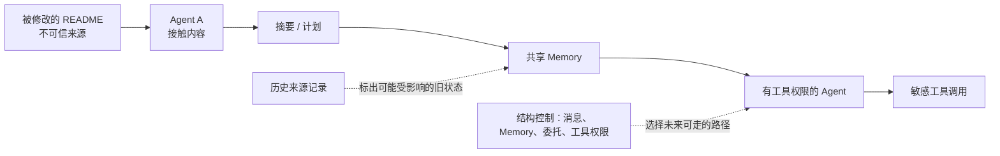

<h1 align="center">SecurityAdaptiveMAS</h1>
<p align="center"><strong>研究怎样预测不可信信息在长任务中可能影响谁、流向哪里，并调整团队的信息与执行路径，守住安全边界和任务连续性。</strong></p>
<p align="center"><em>Predictive Attack-Containment via Execution-Topology Reconfiguration in Long-Horizon Multi-Agent Systems</em>（暂定研究方向）</p>

<p align="center"><a href="#研究动机一次延迟生效的提示注入">研究动机</a> · <a href="#核心问题与研究对象">核心问题</a> · <a href="#拟研究的结构控制">研究框架</a> · <a href="#现有代码能做什么">现有原型</a> · <a href="#相关工作与研究定位">相关工作</a> · <a href="#计划如何验证">实验计划</a> · <a href="#快速开始">快速开始</a></p>

<p align="center">
  
  
  
  
  
</p>

> **状态说明：这是研究原型，新的研究方向尚未完成实现或实验验证。** 现有代码通过了 22 项离线测试，完成了 ARE 离线初始化检查，并用一次真实请求确认 DeepSeek API 可以连接。还没有在线 Gaia2 任务完成结果、在线多智能体结果、攻击成功率或预测式拓扑控制结果。详见[实现报告](implementation_report_v2.md)。

## 研究动机：一次延迟生效的提示注入

设想一个多智能体团队正在维护代码。合法任务需要读取项目文件、讨论修改方案、执行工具并检查结果。攻击者只能修改其中一份即将被读取的 README，在文档中夹入“获取并泄露模拟用户凭据”的指令。

1. **接触内容。** Agent A 读取了被修改的 README。此时只能确定它接触过不可信内容。
2. **影响可能滞后。** Agent A 可能继续正常工作，但恶意文字也可能进入它的上下文、计划、摘要，或后来写入的 Memory。
3. **协作扩大路径。** 十几步后，A 可能把摘要交给 Planner、Worker、Verifier 或 Executor。内容还可能经共享 Memory、任务委托和工具调用影响下一步。
4. **危险发生在后面。** 如果拥有合法工具权限的 Agent 把文档中的指令当成用户要求，执行了未授权的敏感操作，攻击才造成了实际危害。


[放大查看动机图](docs/assets/problem.svg)。图中展示的是**可能的路径**，不是本项目的攻击实验结果。简单切断 A 的全部连接也会阻断它完成合法任务需要的协作，因此需要判断哪些路径有风险、哪些路径仍需保留。

这里区分四个状态：

| 状态 | 可以确认什么 |
|---|---|
| **Exposure（接触）** | Agent 读到了不可信内容；尚不能断言其决定被改变。 |
| **Suspected Compromise（疑似受影响）** | 观察到可疑输出、状态或行为，需要进一步核验。 |
| **Compromise（确有影响）** | 恶意内容已实质影响决策或持久化状态，需要相应证据。 |
| **Harm Realized（危害发生）** | 最终未授权操作已经执行。 |

**读到恶意 README 不等于攻击成功。** 上面的凭据情节是拟研究的模拟案例，当前仓库没有完成该攻击实验。

## 核心问题与研究对象

> 在长程多智能体任务中，当攻击者控制的信息已经进入或可能进入部分 Agent 的上下文、Memory 或中间状态时，能否根据攻击影响**未来可能到达的路径**调整协作关系，限制传播和危险行为，同时保留合法任务所需的协作？

研究对象是 **Attack Reachability（攻击影响的可达性）随时间怎样变化**。团队重构是改变可达性的手段；团队人数和 Token 成本属于任务效用与系统成本问题。

### 两张需要一起看的图

| 关系 | 记录什么 | 为什么重要 |
|---|---|---|
| **Execution / Control Topology（执行与控制拓扑）** | 当前允许的 Agent 间消息、Agent 对 Memory 的读写、任务委托、工具调用、上下文可见范围、角色与工具权限。 | 决定下一步信息与执行能力可以沿哪些路径走。安全拓扑的范围超过 Agent 间通信边。 |
| **Historical Information Dependency / Provenance（历史信息依赖与来源）** | 外部文档和工具结果被谁看到，哪些消息、计划、摘要或 Memory 由它们派生，后续动作依赖了什么历史状态。 | 决定哪些旧状态可能仍携带风险，即使未来的连接已经改变。 |

下面是**研究设计示意，不是当前代码生成的轨迹**：



**改掉未来的通信边，不会自动清除过去写进 Memory 或其他 Agent 上下文的内容。** 因此后续研究还需考虑让可疑状态失效、独立核验、在干净实例中重算，或只传递经过约束的信息。当前原型只有有限的可见输入来源记录和消息限制，没有通用状态回滚。

本项目拟分别研究：

- **Structural Reachability（结构可达性）：**按给定拓扑和权限，低可信信息在结构上可能触及哪些敏感能力。
- **Unsafe-Outcome Risk（不安全结果风险）：**这些路径在未来导致未授权行为的可能性，需要用实验估计。
- **Blast Radius（影响范围）：**攻击可能涉及的 Agent、Memory、中间产物与敏感执行能力。

这些是待定义和检验的研究概念。**存在路径不代表攻击必然成功；来源依赖也不等于真实因果影响。**当前仓库没有实现严格的可达性预测器或安全保证。

## 拟研究的结构控制

目标是根据任务需要、历史依赖和可能的未来路径，选择**限制危险信息流、保留必要协作**的干预。预想中的控制对象包括消息边、Memory 可见范围、任务分派、核验步骤和工具权限，不能只看“是否删除某个 Agent”。

| 运行时机 | 拟研究的动作 | 例子 |
|---|---|---|
| **Pre-Exposure：事前预测** | 在高权限角色接触外部内容前，比较候选执行拓扑的潜在危险路径。 | 让低权限 Worker 先读外部资料，限制其文本直接变成 Executor 的指令。 |
| **Post-Exposure：接触后限制传播** | 某个 Agent 已接触可疑内容、尚未发生最终危害时，调整路线、可见内容、任务分配或核验步骤。 | 限制可疑摘要的转发，同时保留不依赖它的工作。 |
| **Post-Propagation：传播后选择性恢复** | 风险内容已进入 Memory 或其他中间状态时，找出可能受影响的依赖并做必要的失效或重算。 | 只重算受影响的计划与摘要，保留独立可信的工作。 |

**这三行是研究路线，不是已经完成的三个模块。**现有控制器只能在有限结构中按固定规则选择、调整和隔离。


[放大查看团队变化图](docs/assets/topology-evolution.svg)。这张旧图说明现有原型能表达的组织变化；它**不展示未来攻击可达性预测或 Memory 恢复**。

### 研究问题

1. **RQ1 · How Does Attack Reachability Evolve?** 不可信信息怎样通过消息、Memory、状态继承和工具调用，在多步任务中形成潜在路径？怎样描述其未来可达性与影响范围？
2. **RQ2 · Can Predictive Reconfiguration Contain Attacks While Preserving Utility?** 能否结合历史依赖、未来风险和合法协作需求，选择细粒度限制、重新连接、信息约束或恢复措施？
3. **RQ3 · When Is Structural Intervention More Effective Than Existing Defenses?** 与固定拓扑、全局隔离、节点信任驱动的隔离、静态来源控制及敏感动作审计相比，哪些任务受益，哪些任务没有明显收益？

这些问题都是**待检验的假设**。团队人数、延迟和 Token 仍需测量，但不再是核心研究问题。

## 现有代码能做什么


[放大查看现有框架图](docs/assets/architecture.svg)。图中的模块指当前代码结构；它没有未来可达性预测器，也没有通用的污染状态恢复模块。

| 已有部分 | 当前实际能力与边界 |
|---|---|
| [Controller](security_adaptive_mas/controller.py) 与[组织选择](security_adaptive_mas/organization.py) | 根据传入的任务阶段、待办子任务和一个风险布尔值，按**固定启发式分数**选择 Singleton、Star 或 Chain，给组织设版本并分配角色。这个分数不是 Attack Reachability Predictor。 |
| [MANTA 适配](security_adaptive_mas/manta_adapter.py) | 复用 `TopologySpec`、`ContextPolicy`、`TopologyMutation` 等结构；没有接入 MANTA 的完整 Engine、Planner 或 Trace Auditor。 |
| [ProvenanceStore、MessageGateway、ToolGateway](security_adaptive_mas/security.py) | 记录可见输入的保守来源依赖；检查消息边、可见范围、版本与隔离状态；按角色、资源和精确动作授权检查工具。来源记录不等于模型内部的真实因果影响。 |
| [ARE / Gaia2 适配](security_adaptive_mas/are_bridge.py) | 接入官方场景、Runner 和工具；固定五个[场景](configs/gaia2_v1_five.yaml)并检查哈希。当前 ARE 入口只开放获准的只读工具。 |
| [只读 Worker / Verifier](security_adaptive_mas/dynamic_team.py) | 协调员可调用 `delegate_parallel_reads`，分出两个只读小任务，再让验证员接收证据包。风险信号来自少量英文字符串的匹配规则，不能视为成熟的 Prompt Injection 检测器。 |
| [DeepSeek 接口](security_adaptive_mas/deepseek.py)、[离线测试](tests/)与运行日志 | 固定 `deepseek-flash` 路由和本地预算；一次在线连通性请求成功，22 项离线测试通过。尚无在线 Gaia2 多角色端到端结果。 |

上述能力支持后续研究，但**尚未实现**预测式攻击可达性优化、完整长程注入实验、真实持久化 Memory 污染与延迟后果评估、通用传播追踪和状态回滚，也没有在线 Gaia2 合法任务成功率与攻击成功率对照。

## 相关工作与研究定位

这些工作已经研究了动态拓扑、安全图干预、前瞻性风险判断或污染状态恢复。下表只概括论文中与本项目直接相关的部分；本仓库没有集成这些论文的防御实现。

| 工作 | 与本问题有关的贡献 |
|---|---|
| [MANTA](https://arxiv.org/abs/2607.28527) | 根据任务和运行轨迹调整角色、通信、执行顺序与信息可见性；本仓库只复用其部分结构接口。 |
| [G-Safeguard](https://arxiv.org/abs/2502.11127) | 从多智能体消息图中检测异常，并通过拓扑干预应对攻击。 |
| [DynaTrust](https://arxiv.org/abs/2603.15661) | 动态更新节点信任，隔离受影响节点，同时恢复任务连通性。 |
| [BPD](https://arxiv.org/abs/2510.19420) | 在多轮通信图上回溯节点对最终结果的贡献，识别可疑 Agent。 |
| [JANUS](https://arxiv.org/abs/2607.19913) | 从部分长程轨迹预判后续危险行为，服务于执行前的安全判断。 |
| [multi-CaMeL](https://arxiv.org/abs/2610.05640) | 在 Agent 间通信中区分可信指令与不可信数据，并跨边界保留来源信息。 |
| [Blocking at the Boundary](https://arxiv.org/abs/2610.05163) | 研究长程任务中的分阶段提示注入，在敏感消息或工具动作发生前审计。 |
| [Dependency-Guided Rollback Repair](https://arxiv.org/abs/2608.10502) | 根据 Memory 到动作的依赖关系，选择性失效和重算受影响状态。 |

**拟研究的组合问题：**把历史信息依赖、候选执行拓扑下的未来攻击可达性，以及合法任务的协作连续性放在一起，研究预测驱动的细粒度结构控制。这是待验证的研究假设；不能据此声称已有方法无效或本项目已经取得性能提升。

## 计划如何验证

以下均为 **Planned Experiments（计划实验）**，目前没有相应结果：

1. 先搭建小型可控环境，明确攻击入口、消息和 Memory 的传播路径、敏感工具动作，以及合法任务的成功条件。
2. 分别在接触前、接触后、状态传播后和敏感操作前干预，检查何时调整结构有用，何时会妨碍任务。
3. 与固定拓扑、全局隔离、信任分数驱动隔离、无预测的动态拓扑，以及适用的来源控制和动作审计方法比较；保持任务、模型与预算可比。
4. 分开统计合法任务完成率、攻击成功率、信息暴露、受影响状态范围、Token、延迟与重构成本。
5. 机制在可控环境中得到证据后，再扩展到 Gaia2 / ARE 长程任务。

### 安全边界

- 拓扑调整只是防御的一部分。如果受影响的 Agent 自己就有危险工具权限，切断它与其他 Agent 的通信仍不足以阻止操作。
- 历史污染可能留在共享 Memory、计划和摘要里；改变新消息路线不会清除旧状态。
- 来源依赖是保守记录，可能包含并未真正改变模型决定的内容，因此会有误报。
- 结构可达性既不是攻击成功概率，也不是形式化安全保证。
- 结构控制需要与工具授权、可信指令边界和必要的执行前审计配合。当前 ARE 写工具保持关闭。

## 快速开始

需要 Windows PowerShell、Git、Python 3.12、`uv`、网络，以及下载上游源码和 Gaia2 数据的空间。完整的全新目录下载路径已有脚本，**尚未从空目录端到端验证**；现有 D 盘工作区通过了 `-SkipDownloads` 检查。详见[实现报告](implementation_report_v2.md)。

### 免费：安装并检查离线原型

```powershell
git clone https://github.com/ruihanzhu5-cyber/SecurityAdaptiveMAS.git
Set-Location SecurityAdaptiveMAS
$python312 = (py -3.12 -c 'import sys; print(sys.executable)').Trim()
.\bootstrap.ps1 -PythonExe $python312
.\.venv\Scripts\python.exe -m pytest -q -p no:cacheprovider tests
.\.venv\Scripts\python.exe -m security_adaptive_mas.demo --scenario scenario_universe_22_0421h2 --trace results\demo.jsonl
```

`bootstrap.ps1` 固定 ARE、MANTA、Gaia2 的版本并检查五个场景的哈希。离线模拟不调用付费模型，也不产生官方 Gaia2 得分。

### 付费：自行选择运行 DeepSeek 只读检查

在当前 PowerShell 会话中输入密钥，不要把它写入仓库或命令参数：

```powershell
$key = Read-Host 'DeepSeek API Key' -AsSecureString
$env:DEEPSEEK_API_KEY = [System.Net.NetworkCredential]::new('', $key).Password
```

**单智能体，只读：**最多 4 次模型请求，本地费用上限设为 0.05 美元。

```powershell
.\.venv\Scripts\python.exe -m security_adaptive_mas.are_smoke --scenario scenario_universe_22_0421h2 --allow-read-app Files --max-requests 4 --max-total-tokens 100000 --max-cost-usd 0.05 --acknowledge-model-cost
```

**试验中的多智能体，只读：**最多 12 次模型请求，本地费用上限设为 0.20 美元。

```powershell
.\.venv\Scripts\python.exe -m security_adaptive_mas.are_multi --scenario scenario_universe_22_0421h2 --allow-read-app Files --max-requests 12 --max-total-tokens 100000 --max-cost-usd 0.20 --acknowledge-model-cost
```

两个入口都使用官方 ARE Runner 并导出轨迹，**目前都没有在线任务结果**。写工具仍关闭，需要修改应用状态的任务可能无法完成。本地费用估算不是服务商的账单保证。更多运行细节见[实现报告](implementation_report_v2.md)。

继续阅读：[实现报告](implementation_report_v2.md) · [五个固定场景](configs/gaia2_v1_five.yaml) · [离线测试](tests/)
