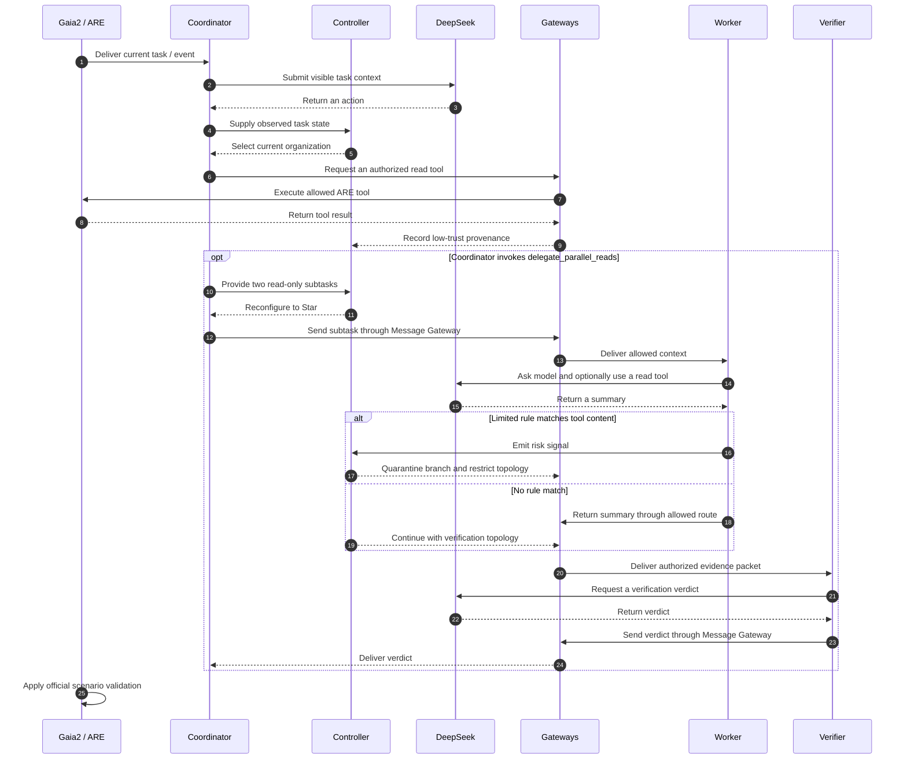

<h1 align="center">SecurityAdaptiveMAS</h1>
<p align="center"><em>Security-Aware Adaptive Multi-Agent Organization for Long-Horizon Tasks</em><br><strong>Adapting agent collaboration without losing control of trust boundaries.</strong></p>

<p align="center"><a href="#why-does-multi-agent-organization-need-to-adapt-securely">Motivation</a> · <a href="#system-architecture">Architecture</a> · <a href="#from-static-teams-to-runtime-organization">Adaptive Topology</a> · <a href="#current-prototype-status">Implementation</a> · <a href="#quick-start">Quick Start</a> · <a href="#limitations-and-roadmap">Roadmap</a></p>

<p align="center">
  
  
  
  
  
</p>

> **Research prototype.** The repository has offline organization and security tests, an offline ARE initialization probe, and one successful DeepSeek API connectivity request. It has **no verified online Gaia2 task success or online dynamic multi-agent result**. See the [v2 implementation report](implementation_report_v2.md) for the evidence and limits.

## Why Does Multi-Agent Organization Need to Adapt Securely?

Adding agents and communication edges can help a team divide work. The same edges can also carry instructions from a lower-trust tool result into summaries and later actions. A topology change alone does not check what an agent can see, send, or execute.


[Open the problem diagram at full size](docs/assets/problem.svg).

**Research question:** Can an agent team adapt its structure to changing task demands while controlling prompt-injection exposure across long-running workflows? The figure is a design contrast, **not** an experimental result.

## Research objectives

| Question | Research target |
|---|---|
| **RQ1 · Temporal safety** | Track low-trust evidence as summaries, agents, and task phases change. |
| **RQ2 · When to organize?** | Detect when observed subtasks or events justify adding or retiring roles. |
| **RQ3 · How to organize securely?** | Select edges, visibility, verification, and permissions under explicit constraints. |
| **RQ4 · Security–performance–cost** | Measure legitimate task success, attack success, latency, tokens, and reconfiguration cost together. |

These are **research objectives**, not completed findings.

## System architecture


[Open the architecture diagram at full size](docs/assets/architecture.svg).

| Layer | What the current code does |
|---|---|
| **Gaia2 / ARE** | Loads five pinned scenarios, initializes simulated apps and tools, runs the official event loop and validator. Online task completion remains unverified. |
| **Controller** | Scores Singleton, Star, and Chain candidates from supplied task state; uses MANTA topology structures; versions organizations and applies route, visibility, provenance, quarantine, and tool checks. Its risk signal is a limited rule, not a general semantic detector. |
| **Agent roles** | An ARE coordinator can call the prototype `delegate_parallel_reads` tool. Two read-only Worker model calls and a Verifier model call share the same Scenario; their messages pass through the gateway. This path has offline tests but no online end-to-end validation. |

The controller enforces permissions in code. DeepSeek supplies model responses; it does not grant its own tool privileges. The actual source is in [`controller.py`](security_adaptive_mas/controller.py), [`security.py`](security_adaptive_mas/security.py), and [`dynamic_team.py`](security_adaptive_mas/dynamic_team.py).

## From Static Teams to Runtime Organization


**Illustrative target workflow.** The offline controller can represent and test reconfiguration, including Star-to-Chain changes. The full four-stage sequence has **not** been demonstrated in a real long-horizon Gaia2 run. [View the figure at full size](docs/assets/topology-evolution.svg).

| Pattern in the planner | Intended use in this prototype |
|---|---|
| **Singleton** | One coordinator at intake. |
| **Star** | Coordinator dispatches two parallel read-only subtasks. |
| **Chain** | Ordered continuation with an authorized direct path to the Verifier. |

Debate and voting topologies are not implemented.

## How the modules interact

The sequence below follows the **implemented code path**. The optional multi-agent and risk branches are still awaiting a real ARE + DeepSeek end-to-end run; the risk rule only recognizes a small set of strings.



## Current Prototype Status

| Capability | State | Evidence / boundary |
|---|---|---|
| Fixed five Gaia2 scenarios and SHA-256 checks | **Implemented; offline-tested** | [`configs/gaia2_v1_five.yaml`](configs/gaia2_v1_five.yaml), [`bootstrap_data.py`](security_adaptive_mas/bootstrap_data.py) |
| MANTA topology structures; Singleton, Star, Chain | **Implemented; offline-tested** | [`manta_adapter.py`](security_adaptive_mas/manta_adapter.py), [`organization.py`](security_adaptive_mas/organization.py) |
| Offline reconfiguration, provenance, message/tool gateways | **Implemented; offline-tested** | [`test_system.py`](tests/test_system.py); tests exercise exact-action grants and route checks |
| DeepSeek V4.1 Flash connectivity | **One online request verified** | `OK`; 11 input + 1 output token. This proves connectivity only; see [report](implementation_report_v2.md). |
| ARE scenario initialization and official loop | **Offline probe verified** | Official importer, initialization, event loop, validator, and export; no model-driven task completion. |
| ARE Single Agent smoke entry | **Wired; online run pending** | Read-only [`are_smoke.py`](security_adaptive_mas/are_smoke.py) |
| Dynamic Multi-Agent tool path | **Offline-tested; online run pending** | [`dynamic_team.py`](security_adaptive_mas/dynamic_team.py), [`test_dynamic_team.py`](tests/test_dynamic_team.py) |
| Semantic risk detection and long-horizon attack evaluation | **Partial rule / planned evaluation** | A limited string rule exists; no attack success study. |
| Fixed/adaptive baseline comparisons | **Planned** | No comparative scores or performance claims. |

The [v2 report](implementation_report_v2.md) records **22 passing offline tests** in the reviewed state. Those tests measure code behavior; they are not a Gaia2 benchmark score.

## Built on Existing Research

| Project | Role here | Boundary |
|---|---|---|
| [Gaia2 / ARE](https://github.com/facebookresearch/meta-agents-research-environments) | Directly reused scenario importer, simulated applications, tools, runner, events, and validator. | The five pinned scenarios remain official; online success is unmeasured. |
| [MANTA](https://github.com/mao-code/MANTA) | Directly reused `TopologySpec`, `ContextPolicy`, and `TopologyMutation`. | Its full engine, planner, and trace auditor are not integrated. |
| [G-Safeguard](https://github.com/wslong20/G-safeguard) | Related security-topology research and a possible future comparison. | No G-Safeguard implementation is imported. |
| [DeepSeek V4.1 Flash](https://api-docs.deepseek.com/news/news260910/) | Fixed LLM route (`deepseek-flash`) for agent model calls. | Connectivity was checked once; ARE task execution is still pending. |

This is an independent prototype, not an official extension endorsed by those projects.

## Quick Start

**Prerequisites:** Windows PowerShell, Git, Python 3.12, `uv`, network access, and space for the pinned upstream sources and Gaia2 data. The full clean-checkout download path is scripted but has **not** yet been validated from an empty directory. The existing D-drive workspace passed `-SkipDownloads` verification; details are in the [implementation report](implementation_report_v2.md).

### Free: clone, bootstrap, and inspect the offline prototype

```powershell
git clone https://github.com/ruihanzhu5-cyber/SecurityAdaptiveMAS.git
Set-Location SecurityAdaptiveMAS
$python312 = (py -3.12 -c 'import sys; print(sys.executable)').Trim()
.\bootstrap.ps1 -PythonExe $python312
.\.venv\Scripts\python.exe -m pytest -q -p no:cacheprovider tests
.\.venv\Scripts\python.exe -m security_adaptive_mas.demo --scenario scenario_universe_22_0421h2 --trace results\demo.jsonl
```

`bootstrap.ps1` pins ARE, MANTA, Gaia2 revisions and checks the fixed scenario hashes. `offline_mock` runs local control tests and a demo; it does **not** call a paid model or produce an official Gaia2 score.

### Paid: configure DeepSeek, then opt in to an ARE smoke run

Set the key only in the current PowerShell process. Do not commit it or place it in a command argument:

```powershell
$key = Read-Host 'DeepSeek API Key' -AsSecureString
$env:DEEPSEEK_API_KEY = [System.Net.NetworkCredential]::new('', $key).Password
```

**Single Agent, read-only** — at most 4 model requests; local cost budget USD 0.05:

```powershell
.\.venv\Scripts\python.exe -m security_adaptive_mas.are_smoke --scenario scenario_universe_22_0421h2 --allow-read-app Files --max-requests 4 --max-total-tokens 100000 --max-cost-usd 0.05 --acknowledge-model-cost
```

**Experimental Multi-Agent, read-only** — at most 12 model requests; local cost budget USD 0.20:

```powershell
.\.venv\Scripts\python.exe -m security_adaptive_mas.are_multi --scenario scenario_universe_22_0421h2 --allow-read-app Files --max-requests 12 --max-total-tokens 100000 --max-cost-usd 0.20 --acknowledge-model-cost
```

Both modes preserve the official ARE runner and export a trace, but neither has an online result yet. Their write tools are closed, so tasks requiring state changes may not complete. Budgets are local estimates, not a guarantee about provider billing. See [run details and limitations](implementation_report_v2.md).

## Limitations and Roadmap

| Current boundary | Next research step |
|---|---|
| Online ARE task success and real dynamic-team triggering are unverified. | Run separately authorized, bounded Single and Multi smoke tests; inspect official traces. |
| Task phases and parallel subtasks are supplied through a narrow runtime tool path. | Derive state from observed events and trajectories across long workflows. |
| Risk detection is a small rule set; provenance is conservative visible-input tracking. | Evaluate semantic injection signals and rebuild contaminated summaries or shared context after reconfiguration. |
| Real ARE writes remain disabled. | Bind exact task authorization to actions and reconcile remote state before enabling writes. |
| No Attack Overlay or comparable baselines exist. | Add isolated attack overlays, fixed/adaptive baselines, and separate legitimate/attacker success scoring. |
| No security–performance–cost claim is supported yet. | Compare outcomes, tokens, latency, agent count, and reconfiguration under matched budgets. |

**Further reading:** [Implementation report](implementation_report_v2.md) · [Fixed scenario configuration](configs/gaia2_v1_five.yaml) · [Offline tests](tests/)
