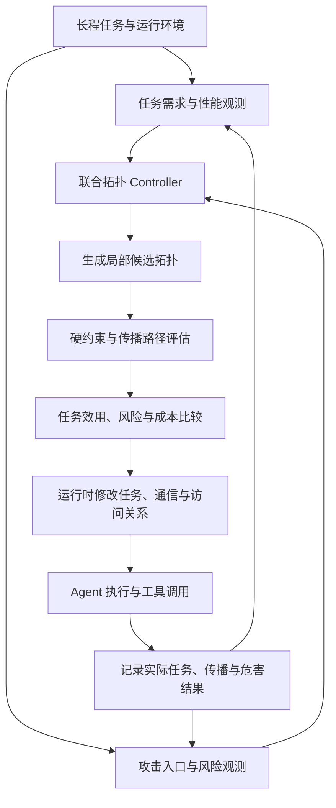

# Safety-Constrained Adaptive Organization for Long-Horizon Multi-Agent Systems

**面向长程多智能体任务的攻击感知自适应拓扑与安全协作方法**

> 研究方案（修订稿）｜2026 年 10 月 13 日  
> 项目：[SecurityAdaptiveMAS](https://github.com/ruihanzhu5-cyber/SecurityAdaptiveMAS)  
> 研究定位：多智能体系统自身的安全；以任务驱动的动态组织为性能基础，以攻击传播控制为安全目标。

## 摘要

长程多智能体任务的协作需求随执行过程持续变化。固定的 Agent 数量、分工和通信关系可能造成不必要的协调成本，而仅根据性能指标调整拓扑，又可能建立新的攻击传播路径。当外部文档、工具返回结果或持久记忆中存在 Prompt Injection、Memory Poisoning 等恶意内容时，攻击影响可能跨越多个 Agent 和执行阶段，直至后续的敏感操作才产生实际危害。

本研究拟提出一种**任务需求与攻击风险联合驱动的在线拓扑控制方法**。Controller 根据当前可观察的任务依赖、运行成本、低可信入口及可疑节点状态，按需创建或调整 Agent、通信边、共享状态访问关系和执行责任。安全目标包括两个互补阶段：在攻击尚未到达关键目标时降低潜在攻击可达性；在部分 Agent 已受影响后控制进一步传播的波及范围。方法同时保留合法任务所需的信息依赖，通过安全约束下的候选拓扑选择与局部重组，研究安全效果、任务完成能力和执行成本之间的权衡。上述性能与安全收益均属于**待实验检验的假设**，不是现有系统的已证结论。

---

## 1. 研究背景与动机（Motivation）

### 1.1 长程任务中的协作需求变化

现有多智能体系统通常采用预设分工或固定通信结构，例如 Star、Chain、层级结构或预先定义的 Agent 工作流。然而，一个长程任务包含的信息探索、任务分解、并行执行、结果合并和敏感操作等阶段，所需的协作方式并不相同。较简单、依赖紧密的阶段可能只需要单个 Agent；存在多个相互独立的子任务时，并行 Worker 才可能带来收益；任务依赖重新出现后，多余的通信与协调又会引入额外成本。

*Benefits and Limitations of Communication in Multi-Agent Reasoning* 从理论上分析任务依赖、Agent 数量、通信量与可实现加速之间的关系；*Understanding Multi-Agent LLM Frameworks*（MAFBench）从框架层面考察不同编排架构对性能与开销的影响。MANTA、DyTopo 和 SAIGE 进一步说明，按任务需要调整协作关系具有现实价值。因此，本研究不将“允许动态图”本身视为创新，而关注**基于执行过程中已知的任务信息进行按需组织，并量化其收益与代价**。

### 1.2 动态拓扑中的攻击传播风险

多 Agent 协作不仅传递任务结果，也可能转发低可信内容。攻击者可将恶意指令放入网页、文件、工具响应、消息或持久记忆中，使其先影响读取内容的 Agent，再通过摘要、任务委托、共享状态或后续工具调用传播到其他 Agent。长程执行使攻击入口与最终危险行为之间可能相隔多个步骤，因而不能只考察注入发生当轮的即时结果。

拓扑调整会改变可访问对象、信息路径与执行责任。一次以降低成本为目标的重组，可能让原本无法接触某项敏感操作的受影响结果进入新的 Executor；反过来，移除传播边、重新分工或将敏感执行与低可信内容处理分离，也可能限制风险扩散。但**结构上存在路径只表示潜在影响机会，不等价于 Agent 被攻陷，更不等价于攻击成功**。

### 1.3 性能优化与安全控制的联合需求

静态拓扑安全比较已由 *Architecture Matters for Multi-Agent Security* 等工作研究；MANTA、ATM 和 DyTopo 已探索运行时拓扑修改；DynaTrust 已通过动态信任图研究可疑或恶意 Agent 的隔离与连接恢复；SafeFlow 已研究恶意语义在动态协作流程中的传播和阻断。因此，单独提出“拓扑影响安全”“运行时改图”“检测后隔离”或“跟踪危险信息”均不足以构成本文的主要贡献。

本研究进一步聚焦于**同一个在线组织决策中，同时考虑任务依赖与攻击传播风险**：在尚未发生实质危害时减少通向关键目标的可利用路径；在部分节点受影响后，局部收缩风险传播范围并寻找能够维持合法任务的替代协作结构。安全约束不作为性能决策结束后的简单拦截器，而直接参与候选组织的生成、评估与选择。

---

## 2. 研究对象与威胁模型（Problem Setting and Threat Model）

### 2.1 系统边界

研究对象是执行多阶段工具任务的 LLM 多智能体系统。系统由一个 Controller 管理运行中的 Agent 实例、任务分配、消息交付、共享结果和工具访问。Controller 仅使用当时已经观察到的任务、运行事件与风险信号，不预知未来任务轨迹，不直接读取评测 Oracle，也不假设初始阶段必须创建固定数量的 Agent。

组织结构在执行过程中可从单 Agent 起步，并随任务需要产生、删除或修改协作关系。这里的拓扑不仅指 Agent 之间的通信边，还包括对共享 Memory／中间结果的读取关系和工具执行关系；否则删除直接通信边并不能真正切断经共享状态形成的间接传播路径。

### 2.2 攻击者能力与攻击类型

攻击者控制一个或多个**低可信输入表面**，包括工具响应、外部文档、仓库文件、消息内容或允许写入的记忆条目；攻击者不控制受信任用户指令、系统策略、Controller 代码和底层工具权限配置。第一阶段以单一受控入口为主，后续可扩展多入口攻击。

拟评估的攻击覆盖三类：

1. **间接 Prompt Injection**：利用外部资料中的指令改变 Agent 的行为或任务目标。
2. **Memory Poisoning**：污染可被后续步骤检索或继承的中间／持久状态，引发延迟影响。
3. **跨 Agent 指令传播**：攻击性要求经摘要、委托、协作消息或新建 Agent 的输入继续传播。

测试中的危险目标使用模拟凭据、沙箱工具、受控收件人和可验证的环境状态，避免真实敏感数据或外部破坏性操作。

### 2.3 攻击进展与防御阶段

**预防式传播控制（Pre-Propagation Reachability Control）**关注攻击入口已经存在、但尚未到达关键目标的阶段。Controller 根据当前拓扑及运行时信号评估潜在传播路径，必要时提前修改信息和执行关系。

**局部受影响后的遏制（Post-Compromise Containment）**关注一个或多个 Agent 已出现攻击诱导行为、错误目标转移或其他受影响迹象的阶段。Controller 通过限制传播、撤销连接、重新分配任务和替代协作缩小后续影响范围。运行时的风险判断可能误报或漏报；真实受影响状态只供离线评测使用。

**最终危害控制（Harm Prevention）**以是否出现未授权工具调用、实际有害状态变化或攻击目标达成为结果指标。攻击路径削减、受影响节点数量减少和最终攻击失败必须分别测量。

---

## 3. 研究问题与可证伪假设（Research Questions）

### RQ1：任务依赖与运行成本驱动的按需拓扑构建及演化

**Task- and cost-driven adaptive organization for long-horizon multi-agent execution.**

研究任务结构、可并行程度、必要信息依赖与真实运行成本对组织决策的影响。Controller 在运行过程中决定保持单 Agent、按需增加 Worker、调整通信边或收缩协作规模，而非依赖预设的完整团队结构。

**H1：**在相同模型、工具和预算约束下，相比固定组织和仅凭过载触发的重组策略，基于任务依赖与实际成本的按需拓扑策略能够在不降低任务质量的前提下改善成本或完成时间；不具备可利用并行性的任务可能不会获得收益。

### RQ2：攻击感知的动态拓扑传播控制

**Attack-aware topology adaptation for reachability reduction and post-compromise containment.**

安全侧不以历史 Context 的完整性为主要研究对象，而以攻击沿动态协作结构传播所形成的可达机会和潜在后果为对象。具体包含两个互补子问题。

**RQ2a｜攻击可达性削减（Pre-Propagation Reachability Reduction）。** 在已知低可信入口和当前风险信号下，评估候选组织是否形成通向受保护 Agent、共享对象与敏感工具的传播路径，并通过拓扑调整减少不必要的危险可达性。

**RQ2b｜受影响节点的波及范围控制（Post-Compromise Blast-Radius Containment）。** 在部分 Agent 已受攻击影响或呈现可疑行为后，通过局部隔离、路径重定向、任务重分配和替代节点，将后续可传播范围控制在较小的子结构中，同时保留其他 Agent 的合法协作能力。

**H2：**在相同风险检测输入和工具安全网关下，攻击传播风险参与拓扑选择，相比固定拓扑、纯性能重组及简单的检测后隔离，有可能减少关键目标可达性、实际污染扩散及攻击成功率。若仅改变检测器或工具网关即可获得相同结果，则不能将收益归因于动态图控制。

### RQ3：安全、任务效用与执行成本的联合拓扑决策

**Joint optimization of security, task utility, and end-to-end execution cost.**

拓扑变更既可能切断攻击传播，也可能破坏合法子任务所需的信息依赖。本文将合法任务可完成性与安全约束同时纳入候选拓扑评估；当某种重组方案风险较高时，Controller 优先尝试替代信息路径、执行角色或局部验证，而非直接停止全局任务。

**H3：**相较单纯阻断、静态隔离以及安全与性能分离的控制策略，联合重组有可能提高安全完成任务的比例，并在部分任务类型中减少通信、重试或恢复成本。该假设允许出现安全改善但成本上升、或额外隔离导致效用下降的情况。

---

## 4. 拟议方法（Proposed Method）

### 4.1 动态运行组织图

在执行时刻 $t$，使用单一可执行的有类型组织图表示系统：

$$
G_t=(V_t,E_t,\alpha_t), \qquad V_t=A_t\cup M_t\cup T_t\cup R_t
$$

其中，$A_t$ 为运行中的 Agent 实例，$M_t$ 为 Memory 和中间结果对象，$T_t$ 为工具，$R_t$ 为受保护资源；$E_t$ 表示消息发送、状态读取／写入、任务委托和工具执行等有向关系；$\alpha_t$ 记录角色、授权、关系类型、有效时间和执行状态。任务需求 $N_t$、运行观察 $O_t$、剩余预算 $B_t$ 与有限事件记录 $L_t$ 作为 Controller 的辅助决策数据，不再把历史 Context 作为核心优化对象。

动态图 $G_t$ 必须与真实运行绑定，修改关系后实际改变 Agent 接收的信息、承担的任务和可执行的工具操作。仅生成图的文本表示而不改变执行流程，不属于有效的拓扑干预。

### 4.2 事件驱动的性能与风险观测

**性能观测模块**沿用任务依赖、并行机会、通信成本、等待和重试等信号，识别当前组织与任务结构之间的失配。

**攻击风险观测模块**记录低可信入口、异常传播事件、可疑 Agent 行为以及关键目标访问请求。来源标签与事件记录用于定位传播媒介、支持候选图分析，但不承担“证明某个 Agent 已被攻陷”的角色；风险检测器可更换，并在基线中保持一致。

任务依赖改变、新的不可信输入进入、疑似受影响行为、候选信息关系即将建立或敏感工具即将执行时，触发候选拓扑评估。一般模型输出不必每次都重新搜索全部拓扑。

### 4.3 攻击可达性与波及范围评估

设 $S_t$ 为当前已知的低可信入口或疑似风险源，$K$ 为受保护目标集合，$G_t^{\delta}$ 为应用候选重组 $\delta$ 后的组织图。基于具有类型、权限和有效时间约束的传播关系，定义**潜在攻击可达性**：

$$
R_t(\delta)=\sum_{k\in K}w_k\,\mathbf{1}\!\left[\exists\text{ valid propagation path }S_t\leadsto k\text{ in }G_t^{\delta}\right]
$$

其中 $w_k$ 表示保护目标的重要性。该指标只刻画结构允许的潜在影响，不表示恶意指令一定被执行。对于跨步骤 Memory 访问，需要在事件时间展开图上判断传播路径，不能只使用某一个时刻的静态快照。

对已受影响或疑似受影响的节点集合 $C_t$，以候选图中可沿有效关系到达的后继节点集合表示**潜在波及范围**：

$$
B_t^{\mathrm{potential}}(\delta)=\left|\operatorname{Reachable}(C_t,G_t^{\delta})\setminus C_t\right|
$$

同时从真实轨迹统计**实际传播范围** $B^{\mathrm{observed}}$、未授权操作尝试及最终攻击结果。潜在波及范围与实际传播范围分开报告，避免将结构推断当作攻击成功证据。

### 4.4 联合候选拓扑生成与选择

Controller 从当前任务需求出发，生成有限数量、可在运行时执行的候选修改。候选操作包括 `KEEP`、`SPAWN`、`RETIRE`、`ROUTE`、`REASSIGN`、`ISOLATE`、必要信息的选择性交付以及不可信中间结果的局部重新验证。候选不是仅在 Star、Chain 等固定模板之间切换，而是允许针对当前任务与风险改变局部结构。

选择过程分为两个层次：

1. **硬约束验证。** 候选不得扩张用户授权，不得让禁用的工具或资源在重组后重新可用，且必须满足当前执行系统的关系与访问控制；已知不可执行的候选直接排除。
2. **任务—风险—成本比较。** 在可执行候选中，综合估计剩余任务能否完成、攻击可达性、潜在波及范围、Token／调用费用、延迟及重组成本；如果低风险方案会破坏必要的信息依赖，继续搜索能够替代该依赖的局部结构。

拟研究的候选目标可写为：

$$
\delta_t^*\in\arg\min_{\delta\in\mathcal F_t}
\left[\widehat C_t(\delta)+\lambda_R\widehat R_t(\delta)
+\lambda_B\widehat B_t(\delta)+\lambda_U\widehat L_{\mathrm{task}}(\delta)\right]
$$

其中 $\mathcal F_t$ 是满足硬约束的可执行候选集，$\widehat L_{\mathrm{task}}$ 为任务损失估计。该表达式用于明确联合决策对象；权重、估计器和搜索策略尚需实现与消融，不能视为已完成算法。必要时应报告 Pareto 权衡，而非只展示单一加权分数。

### 4.5 闭环控制与局部安全重组

### 4.6 长程攻击示例

一个多 Agent 系统正在执行资料检索、分析和后续授权操作。Worker A 在早期读取的工具结果中遇到注入文本；此时只记录风险入口，不能据此认定 A 已被攻陷。随后，A 生成的摘要进入共享状态，另一个任务阶段需要创建 Executor B。性能型 Controller 可能直接将摘要交给 B，而安全感知 Controller 应比较直接交付、受限交付、重新验证及调整任务分工等候选结构。

若 A 已出现攻击诱导行为，则进入遏制阶段：限制 A 的后续传播关系，必要时由其他 Agent 重新获取合法任务必需的信息，再由具有适当权限的执行节点继续任务。最后分别检查风险内容是否到达 B、受影响节点是否增加、危险操作是否发生以及合法任务是否完成。

---

## 5. 实验设计（Experimental Plan）

### 5.1 评测环境与攻击配置

第一阶段延续现有 Gaia2／ARE 与 DeepSeek Flash 工作流，用于验证真实模型调用、任务执行、轨迹记录和 Controller 集成；在原有场景可支持的范围内增加受控的工具结果注入或 Memory 污染。由于现有五个场景属于已接触 Oracle 的 Development 样本，不能据此报告未见任务的泛化结果。对于不具备可验证攻击目标或写入后果的场景，应另选适当任务或借用 AgentDojo 等环境的注入／状态验证设计，不能虚构攻击成功标签。

正式评测设置无攻击、攻击尚未到达关键目标、部分节点已受影响三组实验。每组使用多个独立任务、不同攻击表面与重复运行；以相同前缀状态或可复现的环境快照作为对照起点，并将 LLM 随机性作为不确定性报告。初期 3 组×10 个案例可用于方法调试，但不应直接视为充分的统计证据。

### 5.2 对照方法

| Baseline | 组织策略 | 安全处理 |
|---|---|---|
| Single Agent | 单 Agent 执行 | 相同工具边界与通用安全网关 |
| Fixed Multi-Agent | 固定 Agent 与通信结构 | 相同检测器／工具边界 |
| Performance-Only Dynamic | 按任务需求与成本调整拓扑 | 相同检测器／工具边界，不用风险优化图 |
| Reactive Isolation | 出现风险后隔离节点并恢复必要连接 | 相同风险信号，作为 DynaTrust 式思想的简化基线；不冒充其完整复现 |
| Safety Filter after Planning | 性能拓扑确定后再阻断不安全关系 | 不做任务保留的联合重组 |
| Ours | 任务与攻击传播风险联合决定组织 | 运行时有效关系控制与硬约束验证 |

所有对照保持模型、可用工具、授权、攻击入口、风险检测输入、预算上限及评估标准一致。不同策略产生的实际 Token 数和执行时间是结果变量，不应人为强制完全相同。

### 5.3 核心指标

| 维度 | 指标 | 解释 |
|---|---|---|
| 任务效用 | Task Success / Safe Task Success | 合法任务完成率／无攻击目标达成的合法完成率 |
| 性能成本 | Token、API Cost、Latency、Reconfiguration Overhead | 真实端到端开销及 Controller 额外成本 |
| 预防阶段 | Weighted Attack Reachability | 尚未到达关键目标时的潜在传播机会 |
| 遏制阶段 | Potential / Observed Blast Radius | 理论可传播范围／轨迹中实际受影响范围 |
| 最终安全 | Attack Success Rate、Unauthorized Actions、Harm | 攻击目标达成、越权尝试和真实环境后果 |
| 持续协作 | Utility after Containment | 局部隔离后合法任务继续完成的能力 |

### 5.4 消融与因果归因

1. **移除攻击感知拓扑选择**：保留相同风险检测器及工具网关，测量动态图安全优化的增量贡献。
2. **移除任务依赖评估**：仅最小化传播路径，量化过度隔离造成的任务损失。
3. **仅采用响应式隔离**：检验提前削减关键目标可达性的价值。
4. **关闭替代协作搜索**：比较直接删边、整体拒绝与局部重分工后的任务继续完成率。
5. **固定组织并保留相同的信息精简能力**：排除性能收益仅来自 Context 缩短的解释。
6. **同状态拓扑干预**：在风险暴露或受影响事件之后，固定任务状态、风险信号、授权和网关，分别运行 `KEEP`、简单隔离与联合重组，对比传播和任务结果。

特别需要报告潜在可达性下降却未降低实际攻击成功率的案例，以及攻击受到遏制但任务明显受损的案例；这些负结果同样决定方法适用边界。

---

## 6. 与相关工作的关系（Related Work）

| 研究方向 | 代表工作 | 已有研究与本文拟议区别 |
|---|---|---|
| 通信必要性与架构性能 | [Benefits and Limitations of Communication](https://arxiv.org/abs/2510.13903)；[MAFBench](https://arxiv.org/abs/2602.03128) | 提供任务依赖、通信与性能关系的理论／实证依据；本文进一步将攻击传播风险纳入在线组织决策。 |
| 动态组织与图路由 | [MANTA](https://arxiv.org/abs/2607.28527)；[DyTopo](https://arxiv.org/abs/2602.06039)；[SAIGE](https://arxiv.org/abs/2609.19759) | 已研究动态拓扑、按需建图与通信匹配；本文不把这些机制单独作为创新。 |
| 安全约束下的运行时重组 | [ATM](https://arxiv.org/abs/2607.20488) | 已使用能力、状态和验证约束保护拓扑修改；本文拟将外部注入的攻击可达性、受影响后的波及范围作为重组优化对象。 |
| 多 Agent 架构安全 | [Architecture Matters](https://proceedings.mlr.press/v306/hagag26a.html)；[ORBIT](https://github.com/wlanderson0/orbit) | 已研究架构选择影响攻击与安全评测；本文聚焦在线干预，而非静态架构比较。 |
| 动态信任与节点遏制 | [DynaTrust](https://arxiv.org/abs/2603.15661) | 已针对 Sleeper Agent 采用动态信任与隔离后重连；本文必须验证面向外部注入、任务需求变化和预防式传播控制的额外价值。 |
| 恶意语义传播控制 | [SafeFlow](https://arxiv.org/abs/2607.25255) | 已通过语义风险标注、动态协作图和工作流级校验阻止有害目标传播；本文重点在组织结构如何因风险而改变，而非仅追踪或检查传播。 |
| 延迟投毒与攻击评测 | [AgentPoison](https://proceedings.neurips.cc/paper_files/paper/2024/hash/eb113910e9c3f6242541c1652e30dfd6-Abstract-Conference.html)；[AgentDojo](https://github.com/ethz-spylab/agentdojo) | 提供记忆投毒与间接注入的威胁和评测依据；本文以长程协作拓扑控制为防御变量。 |

上述区别是**论文拟验证的研究定位**，并不宣称相关工作完全没有相邻机制。尤其是 DynaTrust、SafeFlow 与 ATM，需要在正式实验中设置相同威胁和执行条件，避免只依据研究目标的文字差别主张创新。

---

## 7. 预期贡献（Expected Contributions）

**Contribution 1｜任务驱动的长程按需组织机制。** 建立任务依赖、并行机会与实际执行成本到局部拓扑修改之间的决策过程，评估何时单 Agent 足够、何时多 Agent 协作值得其额外成本。

**Contribution 2｜面向攻击传播的动态拓扑控制方法。** 将攻击关键目标可达性与局部受影响后的潜在波及范围引入候选组织评估，研究预防式削减传播路径和受影响后的局部遏制能否由同一个在线 Controller 实现。

**Contribution 3｜安全—效用—成本联合重组与可归因验证。** 在保持授权和合法任务依赖的前提下选择局部协作替代方案，通过相同检测器／网关、同状态拓扑干预和消融分析，验证收益是否确实来自动态结构决策。

以上均为预期研究贡献；能否形成论文贡献取决于真实攻击、真实执行、稳健对照及负结果分析。

---

## 8. 当前实现基础与后续工作（Implementation Status）

截至 2026 年 10 月 13 日，公开仓库已包含任务与运行事件记录、初步性能监控、候选拓扑结构、MANTA 适配、消息／工具安全网关、来源记录，以及在 ARE 中受限的只读多 Agent 协作演示。`controller.py` 支持模式切换与 Worker 隔离，`dynamic_team.py` 使用规则标记可疑工具输出，`topology_candidates.py` 具备候选定义及验证接口，但这些尚未构成面向攻击可达性或 Blast Radius 的联合决策算法。

同日研究日志记录了 DeepSeek Flash 在五个 Gaia2 Development 场景中的单 Agent `ScenarioRunner.success = true`（5/5），并指出其中三场出现 `MaxIterationsAgentError`；该批运行未接入本项目的自适应多 Agent Controller，也未开展攻击实验，因此不能将其视为安全收益或动态拓扑收益的证据。

后续实现按以下依赖顺序推进：首先确定具有可验证攻击目标的长程任务和受控注入位置；随后把真实运行拓扑扩展到消息、共享状态与敏感工具关系；在此基础上实现候选图的攻击可达性／潜在波及范围评估及联合选择；最后执行成对攻击轨迹、同状态干预和完整消融。早期优先采用现有 ARE／Gaia2 与 DeepSeek API，不依赖强化学习训练，也不从零构建大型 Benchmark。

## 9. 研究结论与定位（Summary）

本项目研究的不是静态拓扑优劣，也不是单独的 Prompt Injection 检测、历史 Context 恢复或节点权限检查，而是**长程执行中任务需求持续变化且外部攻击可能跨阶段传播时，如何利用动态拓扑主动控制攻击影响，同时尽可能保留合法协作能力**。

论文的核心可证伪命题是：**在相同模型、攻击、检测器、工具权限和预算约束下，让任务依赖与攻击传播风险共同决定拓扑，比仅按性能重组或检测后简单隔离，能够获得更好的安全—效用—成本权衡。**
