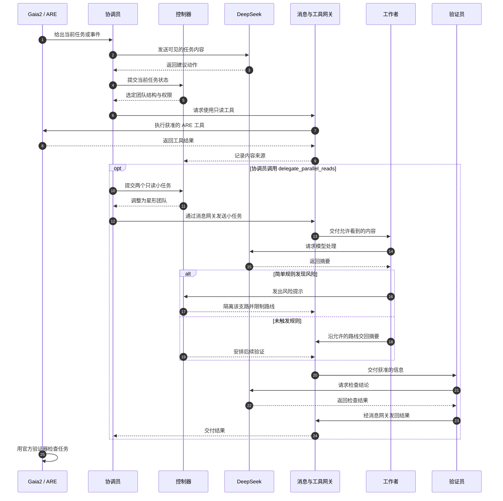

<h1 align="center">SecurityAdaptiveMAS</h1>
<p align="center"><strong>让智能体按任务需要分工，同时看住信息和工具的使用边界。</strong></p>

<p align="center"><a href="#要解决什么问题">问题</a> · <a href="#系统怎样工作">框架</a> · <a href="#团队怎样变化">分工</a> · <a href="#目前做到了哪一步">进度</a> · <a href="#快速开始">上手</a> · <a href="#接下来要验证什么">下一步</a></p>

<p align="center">
  
  
  
  
  
</p>

> **项目进度：研究原型。** 已通过本地模拟测试，也完成了 ARE 的离线初始化检查，并用一次请求确认 DeepSeek API 可以连接。**还没有经过真实在线 Gaia2 任务的完成验证，也没有在线多智能体运行结果。**证据和限制见[实现报告](implementation_report_v2.md)。

## 要解决什么问题

一个任务可能先要查资料，接着要比较信息，最后才能作决定。让多个智能体分别做事，可以分担工作；但它们传递的资料也可能夹带来自网页或工具结果的恶意指令。如果把这些内容直接传给能调用工具的智能体，风险会跟着扩大。


[放大查看问题示意图](docs/assets/problem.svg)。这张图说明设计动机，**不是实验结果**。

项目想回答的问题很直接：**任务变了，团队能否跟着调整，同时明确每个智能体能看到什么、能把消息发给谁、能调用什么工具？**

| 想弄清楚的事 | 具体看什么 |
|---|---|
| 信息从哪里来 | 外部内容被谁读过，又进入了哪些摘要。 |
| 什么时候改变分工 | 当前任务是否真的需要新增工作者、验证员或改变连接。 |
| 改变后怎样管住权限 | 消息路线、可见内容和工具权限是否仍然合适。 |
| 改变是否值得 | 同时看任务完成情况、攻击效果、耗时、令牌和调整成本。 |

这些是**研究目标**，目前没有相应的完整实验结论。

## 系统怎样工作


[放大查看框架图](docs/assets/architecture.svg)。

1. **Gaia2 / ARE 给出任务。** 仓库固定了五个 Gaia2 场景。ARE 提供模拟应用、工具、事件循环和官方验证器。这里的“验证器”负责判断任务结果；它与团队中的验证员角色不同。
2. **协调员读取当前任务。** DeepSeek 生成下一步回复或工具请求。模型负责提出动作，代码负责检查动作能否执行。
3. **控制器决定谁来做。** 它根据当前看到的任务状态，在单人、星形、链式三种团队结构中选择；并记录团队版本、消息路线和权限。这里借用了 MANTA 的团队结构数据类型。
4. **网关检查每次跨边界操作。** 消息网关检查发送者、接收者、路线、团队版本和隔离状态。工具网关检查角色、工具、资源以及写操作是否得到该任务的明确授权。ARE 中的写工具目前关闭。
5. **记录信息来源。** 系统保存模型看到的输入、工具结果和摘要的来源关系。现有风险提示只靠少量字符串规则，不能理解所有恶意指令。

代码入口包括[控制器](security_adaptive_mas/controller.py)、[权限与来源检查](security_adaptive_mas/security.py)和[多智能体工具](security_adaptive_mas/dynamic_team.py)。

**目前可运行的多角色路径：**协调员可以调用 `delegate_parallel_reads`，把两个只读小任务交给工作者，再让验证员检查返回内容。它们共用同一个 ARE 场景，消息经过网关。该路径通过了离线测试，**尚未在线从头到尾跑通**。

## 团队怎样变化


[放大查看团队变化图](docs/assets/topology-evolution.svg)。这是希望在长任务中实现的流程示意。控制器已能在离线测试中调整结构，包括从星形转为链式；**整套四步流程还没有在真实 Gaia2 长任务中得到验证**。

| 结构 | 在这个原型中的用途 |
|---|---|
| **单人（Singleton）** | 刚接到任务时，由协调员先处理。 |
| **星形（Star）** | 协调员分出两个可并行的只读小任务。 |
| **链式（Chain）** | 按顺序继续处理，并把获准的信息交给验证员。 |

辩论、投票等其他团队结构尚未实现。

### 一次任务中的主要调用

下面的图对应代码中的调用路径。多智能体分支和风险分支仍需真实 ARE + DeepSeek 在线验证；当前风险规则只能识别少量字符串。



## 目前做到了哪一步

| 功能 | 目前状态 | 可查证的位置 |
|---|---|---|
| 五个固定 Gaia2 场景及 SHA-256 检查 | 已实现，经过离线测试 | [场景配置](configs/gaia2_v1_five.yaml)、[数据准备代码](security_adaptive_mas/bootstrap_data.py) |
| MANTA 结构及单人、星形、链式团队 | 已实现，经过离线测试 | [MANTA 接口](security_adaptive_mas/manta_adapter.py)、[团队结构](security_adaptive_mas/organization.py) |
| 离线调整、来源记录、消息和工具网关 | 已实现，经过离线测试 | [系统测试](tests/test_system.py)检查了具体动作授权和消息路线 |
| DeepSeek V4.1 Flash 连接 | 一次在线请求成功 | 返回 `OK`，用了 11 个输入令牌和 1 个输出令牌；这只能证明连接可用 |
| ARE 场景初始化及官方循环 | 离线检查通过 | 包括导入、初始化、事件循环、验证和导出；没有模型驱动的任务完成结果 |
| ARE 单智能体入口 | 已接通，待在线运行 | 只读的 [are_smoke.py](security_adaptive_mas/are_smoke.py) |
| 动态多智能体工具路径 | 离线测试通过，待在线运行 | [实现](security_adaptive_mas/dynamic_team.py)、[测试](tests/test_dynamic_team.py) |
| 识别恶意指令、评估长任务攻击 | 只有简单规则，完整评估待做 | 还没有攻击成功率研究 |
| 固定团队与动态团队对照 | 待做 | 目前没有可报告的对照分数 |

[实现报告](implementation_report_v2.md)记录的检查状态是 **22 项离线测试通过**。这些测试检查代码行为，不能当成 Gaia2 任务得分。

## 用到了哪些现有项目

| 项目 | 在这里做什么 | 使用范围 |
|---|---|---|
| [Gaia2 / ARE](https://github.com/facebookresearch/meta-agents-research-environments) | 提供官方场景导入、模拟应用、工具、运行循环和验证器。 | 五个场景保持官方内容；在线完成情况尚未测量。 |
| [MANTA](https://github.com/mao-code/MANTA) | 提供 `TopologySpec`、`ContextPolicy`、`TopologyMutation` 等团队结构。 | 没有接入完整的 MANTA 引擎、规划器或轨迹审计器。 |
| [G-Safeguard](https://github.com/wslong20/G-safeguard) | 相关研究，之后可作为比较对象。 | 当前代码没有导入它的实现。 |
| [DeepSeek V4.1 Flash](https://api-docs.deepseek.com/news/news260910/) | 通过 `deepseek-flash` 为智能体生成回复。 | 只确认过一次连接，真实 ARE 任务仍待运行。 |

这是独立研究原型，与上述项目没有官方合作关系。

## 快速开始

需要 Windows PowerShell、Git、Python 3.12、`uv`、网络，以及下载上游代码和 Gaia2 数据所需的空间。全新目录的完整下载流程已有脚本，**还没有从空目录完整验证**；现有 D 盘工作区通过了 `-SkipDownloads` 检查。详见[实现报告](implementation_report_v2.md)。

### 免费：安装并查看离线原型

```powershell
git clone https://github.com/ruihanzhu5-cyber/SecurityAdaptiveMAS.git
Set-Location SecurityAdaptiveMAS
$python312 = (py -3.12 -c 'import sys; print(sys.executable)').Trim()
.\bootstrap.ps1 -PythonExe $python312
.\.venv\Scripts\python.exe -m pytest -q -p no:cacheprovider tests
.\.venv\Scripts\python.exe -m security_adaptive_mas.demo --scenario scenario_universe_22_0421h2 --trace results\demo.jsonl
```

`bootstrap.ps1` 固定 ARE、MANTA、Gaia2 的版本，并核对五个场景的哈希值。离线模拟不会调用付费模型，也不会产生官方 Gaia2 得分。

### 付费：自行选择运行 DeepSeek 检查

只在当前 PowerShell 会话中输入密钥，别把它写进仓库或命令参数：

```powershell
$key = Read-Host 'DeepSeek API Key' -AsSecureString
$env:DEEPSEEK_API_KEY = [System.Net.NetworkCredential]::new('', $key).Password
```

**单智能体，只读：**最多 4 次模型请求，本地费用上限设为 0.05 美元。

```powershell
.\.venv\Scripts\python.exe -m security_adaptive_mas.are_smoke --scenario scenario_universe_22_0421h2 --allow-read-app Files --max-requests 4 --max-total-tokens 100000 --max-cost-usd 0.05 --acknowledge-model-cost
```

**试验中的多智能体，只读：**最多 12 次模型请求，本地费用上限设为 0.20 美元。

```powershell
.\.venv\Scripts\python.exe -m security_adaptive_mas.are_multi --scenario scenario_universe_22_0421h2 --allow-read-app Files --max-requests 12 --max-total-tokens 100000 --max-cost-usd 0.20 --acknowledge-model-cost
```

两个入口都使用官方 ARE 运行器并导出记录，**目前都没有在线任务结果**。写工具仍关闭，所以需要修改应用状态的任务可能无法完成。费用限制是本地估算，不能保证服务商账单金额。更多细节见[实现报告](implementation_report_v2.md)。

## 接下来要验证什么

| 现在的限制 | 下一步 |
|---|---|
| 尚未确认在线 ARE 任务能否完成，也未确认真实任务何时会触发团队调整。 | 在明确授权的费用范围内分别运行单智能体和多智能体检查，查看官方轨迹。 |
| 当前的小任务和阶段信息来自较窄的运行工具路径。 | 从实际事件和长任务记录中提取这些信息。 |
| 风险识别只靠简单规则，来源记录限于可见输入。 | 测试更复杂的注入，并研究调整团队后如何处理被污染的摘要。 |
| ARE 写工具关闭。 | 在开放写操作前，把任务授权绑定到具体动作并核对应用状态。 |
| 没有攻击叠加测试，也没有固定团队对照。 | 加入隔离的攻击测试，分别统计正常任务与攻击的结果。 |
| 没有足够证据比较安全、效果和成本。 | 在相同预算下比较完成情况、令牌、耗时、团队人数和调整次数。 |

继续阅读：[实现报告](implementation_report_v2.md) · [五个固定场景](configs/gaia2_v1_five.yaml) · [离线测试](tests/)
