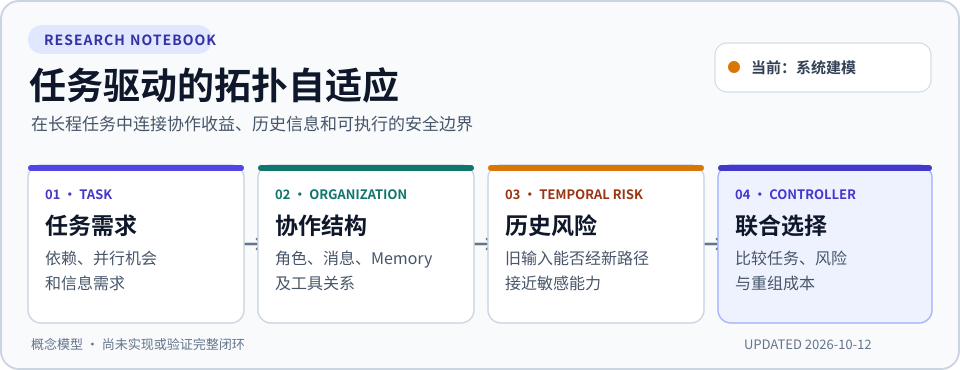
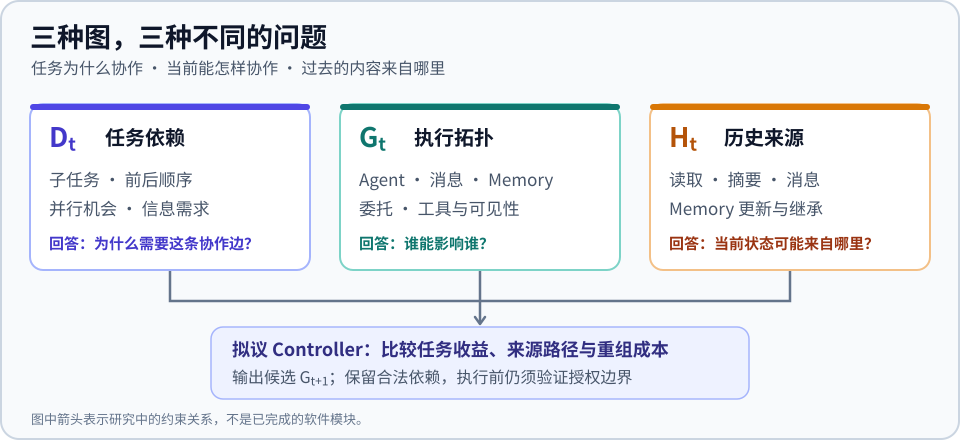
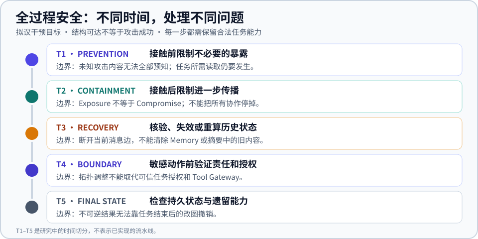

<picture>
  <source media="(max-width: 600px)" srcset="https://github.com/ruihanzhu5-cyber/SecurityAdaptiveMAS/raw/main/docs/assets/research-hero-mobile.svg">
  
</picture>

# SecurityAdaptiveMAS

**面向长程多智能体任务的拓扑自适应与全过程信息流安全约束** 
Task-Driven Adaptive Topology with Temporal Information-Flow Safety Constraints

> **当前阶段：系统建模与问题定义** · **Last Updated: 2026-10-12** 
> 这里记录正在形成的研究问题。三图模型、时间性可达性和联合选择方法均为**拟议研究**；仓库里的工程原型还没有实现这些机制或验证其效果。

[当前看板](#当前研究看板) · [核心问题](#核心问题) · [三图模型](#三图模型拟议) · [最新进展](#最新进展) · [待解决问题](#待解决问题) · [路线图](#研究路线图) · [研究日志](#研究日志) · [现有原型](#现有原型与技术文档)

## 当前研究看板

| 现在在哪一步 | 2026-10-12 的进展 | 紧接着要解决 |
|---|---|---|
| **System Model & Problem Formulation · 进行中** | 把任务依赖 `D_t`、执行拓扑 `G_t`、历史信息依赖 `H_t` 分开；提出 T1–T5 的干预边界 | 定义 Agent/实例、Memory、Capability 和三图的精确时间语义；明确可强制执行的约束 |

| 研究线索 | 当前判断 | 证据状态 |
|---|---|---|
| **性能** | 任务依赖、并行机会、关键路径和共享需求应驱动组织变化 | 问题已提出；收益模型待建立 |
| **安全** | 旧内容可经新 Memory、消息或工具路径影响后续阶段 | 威胁范围初步限定；传播与行为关系待验证 |
| **Controller** | 在任务收益、风险、通信和重组成本之间选择下一阶段拓扑 | 闭环问题已提出；算法未完成 |
| **实验** | 要把拓扑收益与 Tool Gateway、额外核验的收益分开 | 对照与假设已列出；没有正式对比结果 |

**15 秒摘要：**研究对象是长任务中持续变化的多智能体团队。即使没有攻击，任务也可能需要从单人探索转到并行协作、再转到验证；如果早期读入了不可信内容，新拓扑还可能打开过去不存在的信息路径。我们要研究怎样在**继续完成合法任务**时约束这些路径，而不是把接触不可信内容等同于攻击成功。

## 核心问题

> 当协作需求不断变化、历史状态可能受低可信内容影响时，怎样选择下一阶段的执行拓扑，使合法任务继续推进，同时避免不可接受的跨时间信息传播和敏感动作风险？

- **Performance side：**任务结构决定需要哪些角色、并行工作、通信与共享状态；更多 Agent 不必然更快。
- **Security side：**内容来源、状态继承、可见性与工具授权限制哪些新连接可以建立；断开当前消息边不能清除已写入 Memory 的内容。

研究问题保持为四项：**RQ1** 何时按任务调整团队；**RQ2** 如何区分历史接触、未来可能传播和实际危害；**RQ3** 安全约束怎样改变性能驱动的候选排序；**RQ4** 相比固定团队、信任隔离或全面隔离，何时值得付出通信与重组成本。这些都是待检验的问题，不是现有结论。

## 三图模型（拟议）

<picture>
  <source media="(max-width: 600px)" srcset="https://github.com/ruihanzhu5-cyber/SecurityAdaptiveMAS/raw/main/docs/assets/three-graphs-mobile.svg">
  
</picture>

| 图 | 它记录什么 | 要回答的问题 |
|---|---|---|
| **`D_t` · Task Dependency Graph** | 子任务、前后依赖、并行机会与信息需求 | 为什么需要协作？ |
| **`G_t` · Execution Topology** | Agent、Memory、Tool 之间允许的通信、读取、委托和执行关系 | 谁可能影响谁，谁可执行什么？ |
| **`H_t` · Historical Dependency Graph** | 实际发生过的读取、摘要、消息、Memory 更新及来源 | 过去的哪些输入可能影响当前状态？ |

这三张图首先是**系统建模语义**，不要求代码里恰好有三个 Graph 类。`G_t` 也不只是 Agent 间的线；共享 Memory 与工具状态会引入额外路径。Controller 拟观察 `s_t = (D_t, G_t, H_t, E_t, O_t)`（环境 `E_t`、运行观测 `O_t`），并考虑创建/撤销 Agent、调整路由和可见性、限制工具能力或要求复核。任务效用、风险与成本的形式化目标**尚未确定**。

### 为什么跨时间风险不同于一次权限检查

`t1` Worker 读取低可信 README → `t2` 摘要进入共享 Memory → `t3` 任务变化后创建 Executor → `t4` 旧内容可能经新连接接近敏感能力。后续拓扑能改变**潜在可达性**，但存在一条路径并不证明模型受到控制，更不证明危险动作已经发生。

在本项目中，**Exposure** 是确实接触了内容；**Compromise** 需要决策受影响的证据；**Harm** 是受控评测里观察到的未授权结果。来源父链只能保守记录可观察依赖，不能读取模型内部因果过程。第一阶段威胁模型聚焦**外部间接 Prompt Injection 和部分状态污染**，不假定能检测或防御所有攻击。

## 全过程安全：T1–T5（拟议）

<picture>
  <source media="(max-width: 600px)" srcset="https://github.com/ruihanzhu5-cyber/SecurityAdaptiveMAS/raw/main/docs/assets/safety-timeline-mobile.svg">
  
</picture>

| 时间点 | 希望干预什么 | 无法替代什么 |
|---|---|---|
| **T1 · Prevention** | 接触前限制不必要的暴露 | 不能预知所有攻击内容 |
| **T2 · Containment** | 接触后限制进一步传播，同时保留合法协作 | 接触不等于已被控制 |
| **T3 · Recovery** | 核验、失效或重算可能受污染的 Memory 和摘要 | 仅断边不会清除旧状态 |
| **T4 · Boundary** | 敏感动作前调整责任与输入路径 | 拓扑变化不能代替可信授权和 Tool Gateway |
| **T5 · Final-state Safety** | 检查任务结束后的持久状态与遗留能力 | 事后改图不能撤销不可逆损害 |

## 最新进展

**2026-10-12 · 从框架设想推进到系统建模。** 区分 `D_t / G_t / H_t`，提出拓扑重组可能把旧暴露连接到未来敏感能力，并把干预目标拆为 T1–T5。初步写出 Controller 的状态、可控动作和 H1–H3。工程上新增了[仅记录已交付事件的在线观察接口与结构化拓扑候选](docs/online_task_to_topology_phase1.md)；它们尚未接成真正的 ARE 自适应执行。仓库另有一份[Controller 源码审查与集成方案](docs/controller_integration_plan.md)，明确哪些上游机制可复用、哪些只是研究设计。严格图语义、效用估计、选择算法和正式实验仍未完成。[阅读当日记录](docs/research-log/2026-10-12.md)。

**2026-10-11 · 初步研究设想。** 提出 RQ1–RQ4，把任务驱动的组队与外部注入风险放在同一研究问题中；梳理候选 Benchmark、Baseline 和性能—安全—成本对照方向。当日没有得出正式实验结果。[阅读当日记录](docs/research-log/2026-10-11.md)。

## 待解决问题

| 优先级 | 下一项工作 | 完成标志 |
|---|---|---|
| **P0 · 当前** | 区分 Agent 身份、角色、运行实例、Context、Memory 与 Capability；定义三图的节点、边和时间语义；写清 Threat Model 与硬约束 | 一份可被反例检验的系统模型，说明 Controller 能观察和控制什么 |
| **P1 · 接下来** | 建立任务收益/通信成本估计、跨时间可达性、候选拓扑生成与联合选择；研究历史状态失效或重算 | 可计算的决策规则、路径见证与明确的失败条件 |
| **P2 · 后续** | 固定任务、攻击、权限和网关，比较固定组织、仅性能自适应、节点风险与联合选择；做消融 | 可复核的任务完成、安全、时间/Token 和重组成本结果 |

仍需回答的关键反例：如果现有 Tool Gateway 已拦下全部未授权动作，动态拓扑到底增加了什么？如果所有安全候选都切断任务必需依赖，系统怎样降级？如果风险源已直接影响有权限的 Agent，重组是否来得及？[技术方案](docs/controller_integration_plan.md)记录了更完整的风险清单。

## 待检验假设

| 假设 | 能被实验推翻的主张 |
|---|---|
| **H1 · Task-aware adaptation** | 利用任务依赖与信息需求调整组织，比不匹配的固定拓扑更有利于合法任务。 |
| **H2 · History-aware safety** | 结合历史来源与未来拓扑，比只用节点风险分数提供额外的选择依据。 |
| **H3 · Preserve useful work** | 细粒度的安全重组有机会比全面隔离保留更多合法任务能力。 |

如果同一 Tool Gateway 已足以拦下测试中的全部攻击，或联合选择与强对照没有差异，就应如实收窄这些主张。

## 研究路线图

| 阶段 | 目标交付物 | 状态 |
|---|---|---|
| 0 · Research Framing | 研究动机、问题边界、初步对照 | 已形成初稿 |
| **1 · System Model** | 三图、Threat Model、可执行约束与 T1–T5 语义 | **当前进行中** |
| 2 · Decision Mechanism | 可观测状态、候选变更、效用与风险估计、选择规则 | 待开展 |
| 3 · Experimental Protocol | 任务/攻击场景、对照、消融和指标 | 初步构想，待落实 |
| 4 · Implementation | 集成并验证受控的决策闭环 | 目标机制尚未完成 |
| 5 · Evaluation | 性能、安全、成本、恢复和最终状态的结果 | 尚未完成 |

近期交付重点是一份可检验的 *System Model and Problem Formulation for Safety-Constrained Adaptive Multi-Agent Topology*，随后再决定哪些已有组件值得接入。路线图展示**研究顺序**，不是完成百分比。

## 研究日志

| 日期 | 当日研究记录 | 链接 |
|---|---|---|
| **2026-10-12** | 三图语义、跨时间风险、T1–T5、Controller 边界与待验证假设 | [查看](docs/research-log/2026-10-12.md) |
| **2026-10-11** | 初版问题、性能与安全动机、Benchmark 和 Baseline 候选 | [查看](docs/research-log/2026-10-11.md) |

完整索引：[研究日志目录](docs/research-log/README.md) · [新日志模板](docs/research-log/TEMPLATE.md)。旧日志保留当天判断；后续证据若推翻它，应在新日期的日志里说明，不回写成“当时已经知道”。

## 现有原型与技术文档

研究模型与当前工程能力需分开读。现有代码有 Singleton / Star / Chain、固定规则选择、部分 MANTA 结构接口、来源记录和消息/工具网关，以及 ARE 的只读角色路径。根据[2026-10-12 实施报告](implementation_report_v2.md)，曾有 **22 项离线测试**和**一次 DeepSeek 连通性请求**；真实 Gaia2 Single / Multi 任务尚无在线端到端结果。没有完整三图实现、时间性风险优化、污染恢复或正式安全—性能实验。

- [技术概览、复现命令与详细 Related Work](docs/technical-overview.md)：保存此前 README 的技术内容。
- [Controller 集成与研究方案](docs/controller_integration_plan.md)：源码审查、候选方法、强对照、边界和实施顺序。
- [Gaia2 在线任务分析与拓扑候选 Phase 1](docs/online_task_to_topology_phase1.md)：已实现的在线观察边界、D_t 数据契约、结构候选、测试与尚未接通的 ARE 执行环节。
- [Gaia2 / ARE 场景筛选](gaia2_screening_report.md) · [实现报告 v1](implementation_report_v1.md) / [v2](implementation_report_v2.md)。
- [核心代码](security_adaptive_mas/) · [配置](configs/) · [离线测试](tests/)。

## 每日如何维护

1. 从[模板](docs/research-log/TEMPLATE.md)复制出 `docs/research-log/YYYY-MM-DD.md`，只写当天实际提出、改变或验证的内容，并把它加到[日志索引](docs/research-log/README.md)。
2. 更新首页顶部的 **Last Updated**、[当前研究看板](#当前研究看板)和[最新进展](#最新进展)；首页只保留最近 1–2 条记录，其余通过索引查阅。
3. 若证据改变了优先级，同步调整[待解决问题](#待解决问题)与[研究路线图](#研究路线图)，并区分“已实现 / 已验证 / 仅提出”。新实验结果要链接原始报告；没有实验时不填结果。

---

这是持续更新的研究记录。图示与假设用于解释问题，不代表已有安全保证或实验结论。
