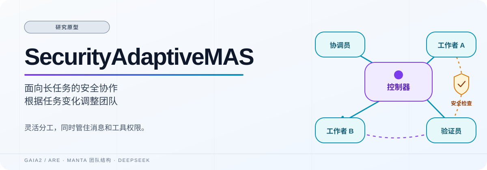
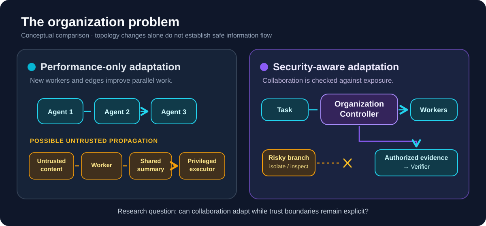
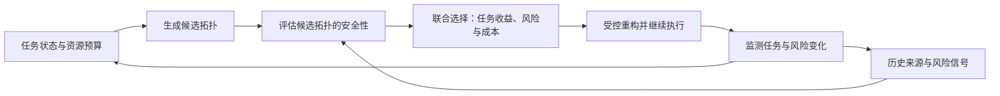
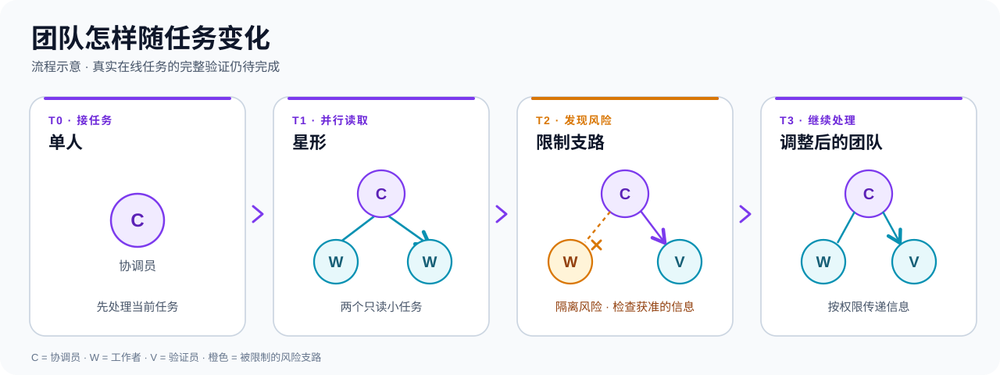
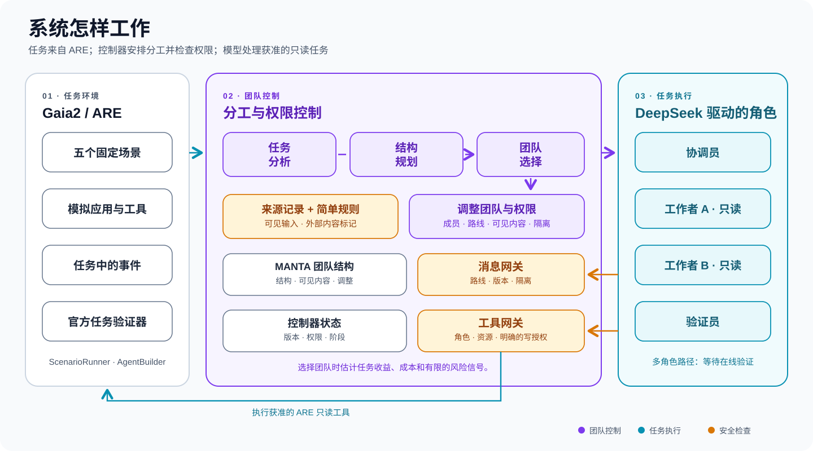

# 技术概览与已有工程原型

> 此文档保存 2026-10-12 之前 README 的技术说明、Related Work、复现命令和原型边界。首页现用于每日研究进展；以下内容按当时的工程状态保留，不表示后续研究模型已实现。[返回研究首页](../README.md)。

---



<h1 align="center">SecurityAdaptiveMAS</h1>
<p align="center"><strong>让多智能体团队随着任务变化调整分工与信息流，并在整个执行过程中检查安全风险。</strong></p>
<p align="center"><em>Safety-Constrained Adaptive Topology for Long-Horizon Multi-Agent Systems</em>（暂定研究标题）</p>

<p align="center"><a href="#研究定位">研究定位</a> · <a href="#为什么任务需要动态团队">性能动机</a> · <a href="#同时考虑性能与安全的例子">完整例子</a> · <a href="#研究问题">研究问题</a> · <a href="#计划中的决策框架">计划框架</a> · <a href="#相关工作与研究定位">相关工作</a> · <a href="#现有原型与边界">现有原型</a> · <a href="#计划如何验证">实验计划</a> · <a href="#快速开始">快速开始</a></p>

<p align="center">
  
  
  
  
  
</p>

> **状态：研究原型。** 当前代码实现了三种基础组织结构、固定规则的选择器、有限的消息与工具检查，以及只读 ARE 入口。22 项离线测试与一次 DeepSeek 连通性请求曾通过；尚无在线 Gaia2 任务得分、在线多智能体结果或本页提出的联合优化实验。[实现报告](../implementation_report_v2.md)记录了已验证的范围。

## 研究定位

本项目的方向是 **Performance-Adaptive Topology under End-to-End Safety Constraints**：以任务需求驱动的动态团队组织为主体，让跨时间的安全约束参与每一次组织选择。任务结构决定需要怎样协作；协作结构决定信息和执行能力怎样传播；安全风险又会改变可接受的组织方式。

我们拟研究一个反复执行的决策：**根据当前任务生成候选拓扑，比较预期任务收益、攻击传播风险和调整团队的成本，再选择能完成工作且满足安全约束的拓扑。**即使没有攻击，团队也应随任务阶段变化；发现风险后，还要在保留合法协作的前提下调整信息流。这里的“拓扑”不只是 Agent 之间的线，还包括角色、任务委托、上下文可见范围、共享 Memory 的读写路径和工具调用能力。

这是**计划中的研究问题和方法**。现有选择器使用固定启发式分数，尚不能预测攻击后果或求解联合优化。

## 为什么任务需要动态团队

长任务在不同阶段需要不同的协作方式。代码维护可能先由一个 Agent 了解仓库；遇到独立模块时让多个 Worker 并行；实现和测试时让 Coder、Reviewer、Tester 分工；集成时收紧顺序依赖；结束时减少多余的通信。需要回答四个实际问题：**何时组队、怎样分工、何时重组，以及收益是否抵得上 Token、等待和协调成本。**任务长短本身不能决定 Agent 数量或通信密度。

这一动机有两类证据，但它们不直接证明本项目的方法有效。[Benefits and Limitations of Communication in Multi-Agent Reasoning](https://arxiv.org/abs/2510.13903)在特定理论任务及受控实验中说明：Associative Recall 可能只需少量通信，State Tracking 在条件满足时可从并行协作获益，k-hop Reasoning 仍有不能靠增加 Agent 消除的顺序依赖。[Architectural Design, Not Only Model Intelligence, Governs Multi-Agent LLM Performance](https://arxiv.org/abs/2602.03128)通过 MAFBench 分析多智能体框架的架构选择与性能差异。这些工作支持**按任务依赖评估组织方式**，不能推出某个固定图形对所有真实长任务最优。

## 同时考虑性能与安全的例子

下表是**拟用于研究的情境**，不是已运行的攻击轨迹。合法任务是维护代码；攻击者只控制一个将被读取的 README，在其中加入诱导读取并外传**模拟凭据**的文字，目标地址也是受控测试地址，不涉及真实秘密。

| 任务进度 | 任务为何可能需要换拓扑 | 同时需要检查的安全问题 |
|---|---|---|
| Step 1：了解仓库 | 一个 Agent 阅读需求和目录，额外组队可能只增加开销。 | 外部文件应作为数据处理。 |
| Step 5：两个独立模块出现 | 即使**没有攻击**，两个 Worker 并行研究也可能比单人顺序处理更合适。 | 分工和可见范围仍须与任务匹配。 |
| Step 8：Worker 读取被改写的 README | 正常分析仍需继续。 | 只能确认 **Exposure（接触）**，不能因此断言 Worker 已被控制。 |
| Step 11：生成摘要或共享状态 | 下一阶段可能需要 Planner 汇总信息。 | 恶意文字可能残留在摘要、上下文或 Memory；是否实际改变决定须另找证据。 |
| Step 13：需要 Executor | 合法实现/测试需要具备相应工具能力的角色。 | 新的消息、Memory 或委托路径可能让旧内容接近敏感能力；只检查新 Agent 的权限不够。 |
| Step 15：比较候选组织 | 在继续并行、增加核验、限制可见性、改派工作之间比较任务收益与成本。 | 排除违反硬约束的方案，估计剩余危险路径；避免一概停掉合法任务。 |
| Step 18：准备敏感动作 | 执行前确认动作服务于原任务。 | 若模拟凭据被发送到受控攻击地址，才记为相应攻击结果；单纯存在路径不是成功。 |



[放大查看动机图](assets/problem.svg)。**无攻击对照同样关键**：从探索转入可并行模块时，系统仍应考虑重组；完成并行部分后，也应考虑缩减团队。

### 安全约束具体指什么

**权限合规不等于抗攻击。** 一个 Tester 即使只持有合法 Shell 权限，也可能把外部文档中的恶意指令误当成用户要求，用已有权限做出未授权操作。可执行的**硬约束**包括工具白名单、精确动作授权、消息路由与可见范围、可信指令边界，以及重构时的能力继承规则；**预测性风险**则关心候选拓扑是否增加低可信信息到敏感能力的未来路径。这两种判断不能混为一个“安全分数”。

计划中的模型同时看两张图：**执行/控制拓扑**描述未来允许的 Agent 消息、Memory 读写、共享工具状态、任务委托、上下文可见性与工具权限；**历史信息依赖**记录外部内容进入了哪些消息、摘要、计划、Memory 和动作。共享 Memory 或工具状态可能连接原本没有直接消息边的 Agent。修改未来的边不会自动清除过去留下的内容。

| 研究概念 | 应怎样解释 |
|---|---|
| Exposure / Compromise / Harm | 接触不可信信息、确有证据表明决策受影响、以及未授权结果发生，是不同阶段。 |
| Structural Reachability | 给定拓扑与权限时，低可信信息在结构上**可能**触及的角色或能力。 |
| Behavioral Risk | 某种输入在未来**实际诱发**偏离任务的可能性，需要实验估计，不能由路径直接推出。 |
| Blast Radius | 潜在受影响的 Agent、Memory、中间产物与资源范围。 |
| Provenance | 来源与历史依赖的保守记录，不等同于模型内部的语义因果证明。 |

当前仓库没有完整的时序来源图、Memory 污染恢复、攻击成功概率模型或形式化安全保证。如果受影响的 Agent 自己能直接使用危险工具，仅删除 Agent 间通信边也挡不住该工具动作。

## 研究问题

1. **RQ1 · Performance-Driven Topology Adaptation：**任务阶段、并行机会、信息依赖和通信成本如何决定组队、组织方式与重构时机？无攻击时，与固定团队相比能否提高合法任务效用？
2. **RQ2 · Temporal Safety under Topology Evolution：**当拓扑、角色和工具路径变化时，怎样结合历史来源与未来结构路径，区分接触、可能传播和真正危险的动作？
3. **RQ3 · Safety-Constrained Joint Topology Optimization：**在硬约束下，安全风险会怎样改变原本由性能驱动的候选拓扑排序？哪些细粒度改动既限制传播又保留任务所需协作？
4. **RQ4 · Security–Performance–Cost Trade-offs：**与固定团队、只按性能重组、信任隔离或全面隔离相比，何时值得为安全调整付出通信和重构成本，何时没有明显收益？

四个问题均待实现和实验验证。

## 计划中的决策框架

任务变化与风险变化都可以触发重新评估，而不是只有检测到攻击才重组：



**计划步骤：**依据任务依赖和预算生成候选结构；依据历史来源、未来信息流和权限评估风险；先筛掉违反硬约束的方案，再比较预期任务收益、通信成本、重构成本及风险预算；执行角色、边、可见性或核验路径的调整；监测后再次选择。一个可研究的目标是最大化“预期任务效用 − 通信成本 − 重构成本”，同时满足可执行安全约束、资源预算和适当的风险预算。当前代码**没有**求解该目标；现有 risk proxy 也不是可靠的攻击成功概率。

| 同一决策在不同阶段 | 可能研究的调整 |
|---|---|
| **Pre-Exposure：接触前** | 预估读取外部内容后可能形成的路径，预先限制高权限角色的直接接触或转发。 |
| **Post-Exposure：接触后** | 根据观察到的来源和风险信号调整路由、可见性、任务分派或核验，继续独立的合法工作。 |
| **Post-Propagation：传播后** | 若内容已进入共享状态，识别可能受影响的依赖，选择性失效、核验或重算。 |

三阶段都属于**计划中的同一拓扑决策过程**，并非已经实现的三个模块。旧的团队演化图仅说明当前原型能表达的少量结构变化：



[放大查看团队变化图](assets/topology-evolution.svg)。

## 相关工作与研究定位

以下按每项工作的**主要研究问题**比较；这些论文与本方向有真实重合，不能把安全和性能简单划成互不相干的两块。文中的“本项目拟研究”均指假设，尚无比较结果；除部分 MANTA 结构接口外，本仓库尚未集成下列方法的完整实现。

### 1. 性能驱动的拓扑自适应

[MANTA — Multi-Agent Network Topology Adaptation for Self-Evolving Multi-Agent Systems](https://arxiv.org/abs/2607.28527)研究任务驱动的运行时组织调整，覆盖角色、通信、执行顺序和可见性，并设置结构变更验证路径。因此本项目不能把“动态调整团队”本身当作新贡献；拟进一步问历史低可信信息如何改变候选结构的安全评价。[ATM — Autonomous Topology Mutation: Safe Runtime Restructuring for Multi-Agent LLM Systems with Capability, State, and Shadow Invariants](https://arxiv.org/abs/2607.20488)更直接地把能力、状态路由和影子验证约束放进运行时变更。与 ATM 的潜在区别应落在**外部攻击内容的跨步来源、未来传播路径和候选拓扑排序**，但必须在同等任务与威胁模型下实证比较，不能仅凭摘要宣称 ATM 没有涉及攻击。

[Benefits and Limitations of Communication in Multi-Agent Reasoning](https://arxiv.org/abs/2510.13903)提供不同任务依赖下通信收益与限制的理论动机；[Architectural Design, Not Only Model Intelligence, Governs Multi-Agent LLM Performance](https://arxiv.org/abs/2602.03128)（MAFBench）分析框架架构与性能差异。前者的理论条件和后者的框架级测量，都不足以直接给出本项目在长程任务中的最优组织策略。

### 2. 安全感知的多智能体架构与拓扑防御

[G-Safeguard — A Topology-Guided Security Lens and Treatment on LLM-based Multi-agent Systems](https://aclanthology.org/2025.acl-long.359/)（ACL 2025）以多智能体消息图检测异常并进行拓扑干预，说明“通过拓扑防御攻击”已有直接先例。[DynaTrust — Defending Multi-Agent Systems Against Sleeper Agents via Dynamic Trust Graphs](https://arxiv.org/abs/2603.15661)通过动态信任图隔离可疑节点、恢复团队连通性；它的主要威胁是 **Sleeper Agent**，与攻击者控制外部 README 的间接提示注入并不等价，而且 DynaTrust 已考虑任务连通性，不能称其只顾安全。[BPD — Securing Multi-Agent Systems Against Corruptions via Node Contribution Backpropagation](https://proceedings.mlr.press/v306/wu26cc.html)（ICML 2026）沿通信贡献图回溯节点影响并识别、隔离恶意 Agent；本项目拟关注的历史文档与 Memory 路径不能由此自动视为未研究领域。

[Architecture Matters for Multi-Agent Security](https://proceedings.mlr.press/v306/hagag26a.html)（ICML 2026）通过控制角色、拓扑和 Memory 等架构因素研究安全与任务表现的关系。[ORBIT — A Framework for Multi-Agent Safety and Security Evaluations](https://arxiv.org/abs/2609.33102)提供可配置的多智能体安全评测框架，涉及拓扑、Memory、调度及安全—性能权衡；本项目不能把这种权衡本身写成首创。[Cross-layer contagion of prompt injections in multi-agent swarms](https://link.springer.com/article/10.1186/s42400-026-00628-w)用 Agent 与共享工具的跨层传播模型说明：只看 Agent 间直接通信可能漏掉共享工具路径。其模型提供建模启发，不等于已证明本项目所设长任务中的行为结果。

### 3. 时间性风险、来源边界与恢复

[JANUS — Foreseeing Latent Risk for Long-Horizon Agent Safety](https://arxiv.org/abs/2607.19913)从部分轨迹预判后续风险；它与拟议的前瞻评估重合，但“预测风险”不自动给出团队结构的选择。[Blocking at the Boundary — Auditing Long-Horizon Agents against Staged Prompt Injection](https://arxiv.org/abs/2610.05163)研究分阶段注入及敏感边界前的审计，提示本项目应把动作前检查纳入对照，不能把网关效果算成拓扑效果。[Can CaMeLs Talk? Securing Multi-Agent Systems Against Indirect Prompt Injection Attacks](https://arxiv.org/abs/2610.05640)（multi-CaMeL）研究跨 Agent 保留不可信来源和指令/数据边界，是来源约束的直接相关工作。[From Faulty Memories to Corrected Actions: Dependency-Guided Rollback Repair for Memory-Augmented Agents](https://arxiv.org/abs/2608.10502)追踪 Memory 到动作的依赖并选择性修复；它提醒我们，重新连边不能代替对已污染状态的处理。

### 4. 对照与拟议研究空缺

| 工作 | 主要目标 | 已覆盖的关键内容 | 本项目拟检验的焦点 |
|---|---|---|---|
| [MANTA](https://arxiv.org/abs/2607.28527) | 任务驱动组织适应 | 运行时角色、边、顺序和可见性调整 | 低可信历史如何改变任务驱动的选择 |
| [ATM](https://arxiv.org/abs/2607.20488) | 安全的运行时拓扑变更 | 能力、状态路由与影子验证不变量 | 跨步攻击内容的可达性约束能否改变候选排序 |
| [G-Safeguard](https://aclanthology.org/2025.acl-long.359/) | 图上的攻击检测与干预 | 消息图异常与拓扑治疗 | 任务收益与历史 Memory 路径共同作用时的选择 |
| [DynaTrust](https://arxiv.org/abs/2603.15661) | Sleeper Agent 信任隔离 | 动态信任、隔离和连通性恢复 | 外部注入威胁下的任务驱动重组与状态继承 |
| [BPD](https://proceedings.mlr.press/v306/wu26cc.html) | 恶意节点识别 | 通信贡献回溯与节点隔离 | 外部内容—Memory—执行能力的跨步路径 |
| [Architecture Matters](https://proceedings.mlr.press/v306/hagag26a.html) | 架构因素与安全表现 | 角色、拓扑、Memory 的受控比较 | 在线选择和调整规则 |
| [ORBIT](https://arxiv.org/abs/2609.33102) | 安全评测 | 可配置架构、攻击与安全—性能测量 | 用于检验联合决策，而非取代评测框架 |
| [JANUS](https://arxiv.org/abs/2607.19913) | 长程风险预判 | 部分轨迹到后续风险信号 | 风险信号怎样进入拓扑选择 |
| [multi-CaMeL](https://arxiv.org/abs/2610.05640) | 跨 Agent 来源边界 | 不可信数据与指令的跨边界约束 | 不同组织下的路径与任务收益 |
| [Blocking at the Boundary](https://arxiv.org/abs/2610.05163) | 分阶段注入审计 | 敏感消息和动作前检查 | 与拓扑控制分开评估贡献 |
| [Dependency-Guided Rollback](https://arxiv.org/abs/2608.10502) | 污染状态修复 | Memory—动作依赖及选择性重算 | 结构调整后怎样处理历史状态 |

**Research Gap and Proposed Positioning：**已有工作分别推进了任务驱动拓扑适应、带不变量的运行时变更、图上隔离、长程风险预判、来源控制和状态修复；ATM、DynaTrust 与 ORBIT 尤其已经触及安全与性能的共同问题。本项目拟问一个更窄、可检验的问题：**当长任务的协作需求发生变化、历史低可信信息又可能影响未来执行时，安全约束会怎样改变原本由任务性能驱动的候选拓扑排序？**例如两种候选都能完成并行分析，但其中一种使先前接触恶意 README 的摘要经共享 Memory 到达 Executor；能否通过改路由或加核验保留并行收益，同时减少实际未授权行为？若实验表明排序没有变化、代价超过收益或对照方法同样有效，就应收窄相应主张。这是**拟议贡献和待验证假设**，不是现有成果。

## 现有原型与边界



[放大查看现有框架图](assets/architecture.svg)。图示的是已有工程连接，不包含已完成的风险预测器。

| 已有部分 | 实际能力与限制 |
|---|---|
| [Controller](../security_adaptive_mas/controller.py) 与[组织选择](../security_adaptive_mas/organization.py) | 根据任务阶段、待办子任务和风险布尔值，用固定启发式分数选择 Singleton、Star、Chain；组织版本和少量隔离规则已存在。它不是联合优化器。 |
| [MANTA 适配](../security_adaptive_mas/manta_adapter.py) | 复用部分 TopologySpec、ContextPolicy、TopologyMutation 接口；未接入完整 Engine、Planner 或 Trace Auditor。 |
| [ProvenanceStore、MessageGateway、ToolGateway](../security_adaptive_mas/security.py) | 保守记录可见输入来源；检查部分消息边、可见范围、版本、隔离和精确工具授权。未实现完整历史因果图。 |
| [ARE / Gaia2 适配](../security_adaptive_mas/are_bridge.py) | 使用官方场景、Runner 和工具；固定五个[场景](../configs/gaia2_v1_five.yaml)及其哈希。当前 ARE 入口只允许获准的只读工具。 |
| [只读 Worker / Verifier](../security_adaptive_mas/dynamic_team.py) | 可并行委派两个只读任务，再交给 Verifier。风险信号只是少量英文字符串的正则匹配，不能当作成熟的注入检测。 |
| [DeepSeek 接口](../security_adaptive_mas/deepseek.py)与[离线测试](../tests/) | 固定 deepseek-flash 路由和本地预算；已有一次在线连通性请求及 22 项离线测试的记录，未得到在线 Gaia2 多角色端到端结果。 |

**当前未完成：**任务依赖驱动的候选生成、可靠的时间性风险估计、跨 Agent/Memory 的完整历史依赖、选择性恢复、可写敏感工具场景，以及正式的安全—性能对照实验。现有角色使用固定 Agent ID；在一次从 Star 转为 Chain 的重构中，原先的 Worker ID 可能被复用为 Verifier，而隔离逻辑只遍历新拓扑中的 Worker。若风险首先出现在第二个 Worker，不能仅凭现有测试推断该 ID 已持续隔离；正式实验前须检查并修正状态继承。当前入口依然保持只读。

## 计划如何验证

以下是**计划实验，没有测量结果**。先分别检验两个命题：①无攻击时，按任务依赖调整拓扑能否比不合适的固定组织提高合法任务效用；②有攻击路径时，安全约束能否改变候选拓扑选择，并在安全与合法任务连续性之间优于只按性能选或一概隔离。结论需按任务类型、威胁模型与预算报告，不能预设总是更好。

| 比较维度 | 计划中的对照与消融 |
|---|---|
| 性能侧 | Single Agent、固定 Multi-Agent、只按性能自适应；条件允许时接入 MANTA 或 ATM 的可比实现。 |
| 安全侧 | 相同网关下的固定拓扑、全面隔离、信任驱动隔离、静态来源策略、动作前守卫；G-Safeguard / DynaTrust 仅在威胁模型与复现条件相符时比较。 |
| 联合方法消融 | 去掉时间性可达性、去掉任务驱动调整、去掉历史/Memory 依赖，各自与完整方案比较。 |

性能指标包括合法任务完成率、Token、时延、Agent 数与创建成本、通信和重构开销。安全指标包括攻击成功率、未授权工具动作率、敏感信息暴露、结构可达范围和受影响状态范围；若实现预测器，还需报告误报、漏报与校准。联合分析安全条件下的任务完成率、恢复能力和安全—性能—成本的权衡。**ToolGateway、权限限制、检测器与拓扑重构要分别消融**，不能把网关带来的防护都记在动态图上。

第一阶段做可控的长程传播实验，明确模拟凭据、受控目的地、攻击入口和合法成功条件；第二阶段在 Gaia2 / ARE 的任务中测动态组织和适用的攻击场景。AgentDojo、MultiAgentDojo、AppWorld 和 ORBIT 仅是后续可评估的候选环境，本仓库尚未完成兼容或评测。所有敏感写入和外传实验应限于受控环境；当前 ARE 入口保持只读。

## 快速开始

需要 Windows PowerShell、Git、Python 3.12、`uv`、网络，以及下载上游源码和 Gaia2 数据的空间。完整的全新目录下载路径已有脚本，**尚未从空目录端到端验证**；现有 D 盘工作区通过了 `-SkipDownloads` 检查。详见[实现报告](../implementation_report_v2.md)。

### 免费：安装并检查离线原型

```powershell
git clone https://github.com/ruihanzhu5-cyber/SecurityAdaptiveMAS.git
Set-Location SecurityAdaptiveMAS
$python312 = (py -3.12 -c 'import sys; print(sys.executable)').Trim()
.\bootstrap.ps1 -PythonExe $python312
.\.venv\Scripts\python.exe -m pytest -q -p no:cacheprovider tests
.\.venv\Scripts\python.exe -m security_adaptive_mas.demo --scenario scenario_universe_22_0421h2 --trace results\demo.jsonl
```

`bootstrap.ps1` 固定 ARE、MANTA、Gaia2 的版本并检查五个场景的哈希。离线模拟不调用付费模型，也不产生官方 Gaia2 得分。

### 付费：自行选择运行 DeepSeek 只读检查

在当前 PowerShell 会话中输入密钥，不要把它写入仓库或命令参数：

```powershell
$key = Read-Host 'DeepSeek API Key' -AsSecureString
$env:DEEPSEEK_API_KEY = [System.Net.NetworkCredential]::new('', $key).Password
```

**单智能体，只读：**最多 4 次模型请求，本地费用上限设为 0.05 美元。

```powershell
.\.venv\Scripts\python.exe -m security_adaptive_mas.are_smoke --scenario scenario_universe_22_0421h2 --allow-read-app Files --max-requests 4 --max-total-tokens 100000 --max-cost-usd 0.05 --acknowledge-model-cost
```

**试验中的多智能体，只读：**最多 12 次模型请求，本地费用上限设为 0.20 美元。

```powershell
.\.venv\Scripts\python.exe -m security_adaptive_mas.are_multi --scenario scenario_universe_22_0421h2 --allow-read-app Files --max-requests 12 --max-total-tokens 100000 --max-cost-usd 0.20 --acknowledge-model-cost
```

两个入口都使用官方 ARE Runner 并导出轨迹，**目前都没有在线任务结果**。写工具仍关闭，需要修改应用状态的任务可能无法完成。本地费用估算不是服务商的账单保证。更多运行细节见[实现报告](../implementation_report_v2.md)。

继续阅读：[实现报告](../implementation_report_v2.md) · [五个固定场景](../configs/gaia2_v1_five.yaml) · [离线测试](../tests/)
